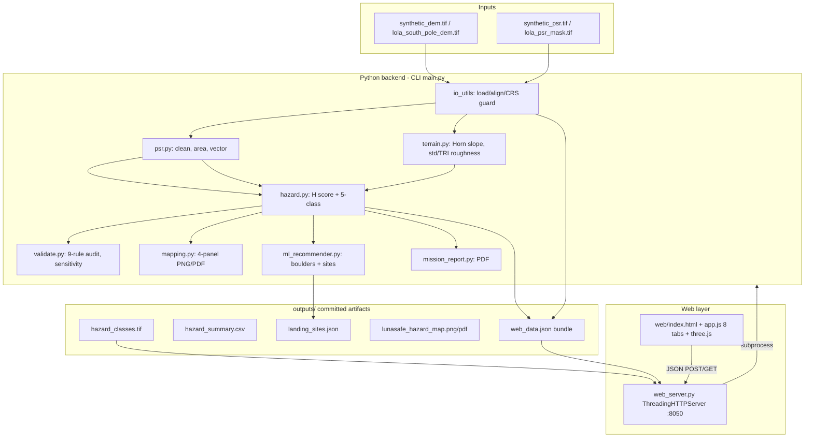
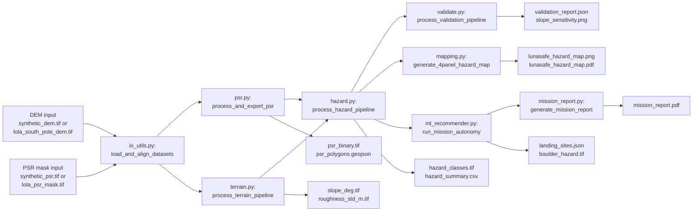
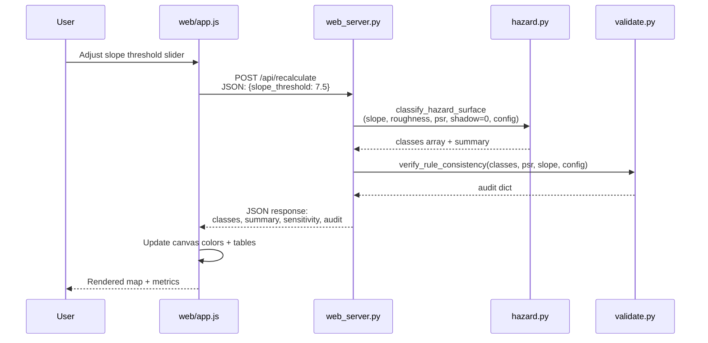
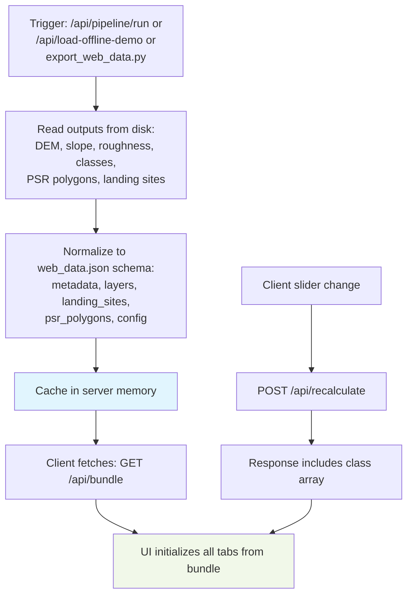

# LunaSafe — Complete Project Documentation

> **Master reference document** (single-file knowledge base)
> **Project:** LunaSafe — Lunar Permanently Shadowed Region Mapping and Surface Hazard Assessment
> **Repository:** `https://github.com/kushbansal2005/ORBISLUNA.git` (local root inspected: `E:\sistec\LunaSafe`)
> **Git state at inspection:** branch `main`, 2 commits (`c3d26dd` 2026-10-12, `fa36e99` 2026-10-17), 91 tracked files
> **Documentation date:** 2026-10-17
> **Primary sources of truth:** (1) the inspected source code, (2) executed command outputs recorded below, (3) the original problem statement, (4) authoritative mission/scientific literature cited with hyperlinks in §7 and Appendix C.

**Evidence labels used throughout** (see Appendix E for the full rules):

| Label | Meaning |
| :--- | :--- |
| **Verified** | Directly supported by inspected code, executed commands, committed data, or authoritative sources |
| **Observed** | Directly observed during this inspection/execution, not scientifically validated |
| **Inferred** | Reasoned interpretation that requires confirmation |
| **Proposed** | Future design or enhancement (not implemented) |
| **Unverified** | Evidence is insufficient to establish the claim |
| **Not implemented** | The capability does not exist in the inspected code |

---

## Table of Contents

- [PART I — Project Identity and Problem](#part-i--project-identity-and-problem)
  - [§4 Identity and Executive Summary](#4-project-identity-and-executive-summary)
  - [§5 Problem Definition and Real-World Need](#5-problem-definition-and-real-world-need)
  - [§6 Requirements Analysis](#6-original-problem-statement-and-requirements-analysis)
- [PART II — Prior Art and Novelty](#part-ii--existing-solutions-and-research-novelty)
  - [§7 Existing Methods and Prior Art](#7-existing-methods-and-prior-art-investigation)
  - [§8 Novelty Assessment](#8-is-lunasafe-new-or-an-improved-version-of-existing-work)
- [PART III — Codebase](#part-iii--actual-codebase)
  - [§9 Repository Audit](#9-complete-repository-audit)
  - [§10 Architecture](#10-actual-project-architecture)
  - [§11 Feature Inventory](#11-complete-feature-inventory)
- [PART IV — Data and Methodology](#part-iv--scientific-data-and-methodology)
  - [§12 Datasets and Provenance](#12-dataset-inventory-and-data-provenance)
  - [§13 Processing Pipeline](#13-end-to-end-processing-pipeline)
  - [§14 Mathematics and Algorithms](#14-mathematical-and-algorithmic-explanation)
  - [§15 Hazard Classification Logic](#15-hazard-classification-logic)
- [PART V — Visualization](#part-v--visualization-and-user-experience)
  - [§16 Mapping and Visualization](#16-mapping-and-visualization)
- [PART VI — Validation and Results](#part-vi--validation-and-results)
  - [§17 Testing and Scientific Validation](#17-testing-and-scientific-validation)
  - [§18 Results and Current Status](#18-results-and-current-project-status)
- [PART VII — Competitive Positioning](#part-vii--competitive-positioning-and-value)
  - [§19 Comparison with Existing Tools](#19-comparison-with-existing-tools-and-approaches)
  - [§20 Unique Value Proposition](#20-unique-value-proposition-and-defensible-differentiation)
- [PART VIII — Development Guide](#part-viii--development-guide)
  - [§21 Technology Stack](#21-technology-stack-and-dependencies)
  - [§22 Installation and Execution](#22-installation-and-execution-instructions)
  - [§23 Developer Onboarding](#23-developer-onboarding-and-code-modification-guide)
- [PART IX — Limitations and Future Work](#part-ix--limitations-risks-and-future-work)
  - [§24 Limitations](#24-scientific-and-technical-limitations)
  - [§25 Risk Register](#25-risks-and-failure-modes)
  - [§26 Roadmap](#26-future-development-roadmap)
- [PART X — Research and Defense](#part-x--research-presentation-and-defense)
  - [§27 Research Questions](#27-research-questions-and-potential-contributions)
  - [§28 Presentation and Viva Preparation](#28-hackathon-presentation-and-viva-preparation)
  - [§29 Glossary, References, Assessment](#29-glossary-and-reference-material)
- [Appendices](#appendices)

---

# PART I — Project Identity and Problem

## 4. Project Identity and Executive Summary

### 4.1 Identity

| Field | Value | Evidence |
| :--- | :--- | :--- |
| **Project name** | LunaSafe | Repository README, `.agents/rules/lunasafe.md` |
| **Title** | Lunar Permanently Shadowed Region Mapping and Surface Hazard Assessment | Problem statement 02 (hackathon brief, restated in repo docs) |
| **Category / domain** | Planetary geospatial software; lunar remote sensing; landing-site screening | Whole codebase |
| **Problem statement** | PSRs near the lunar poles are hard environments (extreme illumination, uncertain terrain). Build a geospatial pipeline that identifies PSRs and generates a classified surface hazard map (slope, roughness, shadow extent), with at least three categories (Safe, Caution, Unsafe), using datasets such as Chandrayaan-2 OHRC/TMC-2 and NASA LRO. | Original problem statement |
| **Objective (implemented)** | A Python pipeline + web console that (a) ingests a lunar DEM and an optional PSR mask, (b) computes slope and roughness, (c) classifies every pixel into five hazard classes, (d) exports maps/JSON/PDF artifacts, and (e) interactively re-tunes thresholds in a browser. | Verified: `main.py:38-234`, `web_server.py`, `hazard.py:61-134` |
| **Authors / history** | Single author visible in git (`Kush <bansalkush2005@gmail.com>`), two commits, no tags, no PRs. | `git log` |

### 4.2 Executive summary (beginner-friendly)

Near the Moon's poles, some crater floors have **never seen sunlight**. Those places — permanently shadowed regions, or **PSRs** — are scientifically precious because they are cold enough to trap water ice, but they are also dangerous: the floors may hide boulders, the walls may be steep, and total darkness makes optical navigation useless. NASA, ISRO and others are planning landers and rovers for the polar region, so someone has to decide *where it is relatively safe to go*.

**LunaSafe** is a small software system that takes a 3-D elevation map of a lunar polar area and produces a **colour-coded hazard map**. It measures how steep each patch of ground is (slope) and how locally rough it is (roughness), combines those measurements with a supplied "is this in permanent shadow?" mask, and assigns each pixel to one of five classes: *NoData, Safe, Caution, Unsafe,* or *Shadowed-Unknown*. The last class exists because **a dark flat crater floor is not automatically safe** — in permanent shadow, orbital cameras cannot see metre-scale rocks, so LunaSafe refuses to call it safe. The system also highlights candidate landing ellipses, draws publication-style maps, writes a PDF report, and lets a user move threshold sliders in a web browser and watch the map re-colour in about a second.

**Honest status:** LunaSafe is a **working research prototype**, not a flight-certified tool. It runs end-to-end on a committed synthetic dataset and on a small NASA LOLA-derived crop; it has 32 passing unit/integration tests; and it has **no independent scientific validation** of its hazard classes against real mission ground truth. Its algorithms (Horn slope, neighbourhood roughness, threshold classification, Euclidean distance transforms) are established techniques. Its clearest contribution is **system integration**: a single offline-capable pipeline that links PSR-aware classification, an audit of its own rules, and an interactive console — with explicit "never invent accuracy numbers" honesty rules.

### 4.3 Executive summary (technical)

LunaSafe implements a 7-phase, file-based geospatial pipeline in Python 3.13 (numpy/scipy/rasterio/geopandas/matplotlib) over an IAU-2015 lunar sphere polar-stereographic CRS (`+proj=stere +lat_0=-90 +R=1737400`; `config.py:62`). Phase chain: ingest/align → PSR binarise, clean, area, vectorise → Horn slope + standard-deviation roughness + Riley TRI → 5-class hazard surface from a weighted score *H = 0.5·S + 0.3·R + 0.2·D* with non-compensatory hard overrides → 300 dpi 4-panel cartography → a 9-rule consistency auditor and slope-sensitivity sweep → an autonomous landing-site recommender (multi-criteria fitness + boulder micro-hazard detection from high-pass residuals). A stdlib `ThreadingHTTPServer` (`web_server.py`, 864 lines, ~20 JSON/file routes, **no authentication**) serves a vanilla-JS single-page console (`web/app.js` ≈4 561 lines, 8 tabs, vendored three.js r128) that can re-run the classifier client-side from a committed `outputs/web_data.json` bundle. Thirty-two pytest cases pass (verified 2026-10-17, 25.28 s). Known defects are registered as issues I-01…I-16 (e.g., the batch-path PSR "validation" compares a mask with itself and always reports 1.0 — I-01; the web audit Rule 4 reads a key the validator never emits and therefore always shows 0 violations — I-03; the committed UI data bundle is stale relative to the committed rasters — I-06). No database, no CI, no environment-variable configuration, no trained model.

### 4.4 What differentiates LunaSafe (evidence-bounded)

| Candidate differentiator | Evidence | Status |
| :--- | :--- | :--- |
| **Class 4 "Shadowed-Unknown"** — shadowed flat ground is classified unknown, not safe | `hazard.py:111-113`; enforced by audit rule 8 (`validate.py:70-148`) | **Verified** as an implementation choice; its superiority over published illumination products is **not** validated |
| **Self-audit (9 rule invariants)** over the classified raster | `validate.py:70-148`, `test_validate.py` mutation test | **Verified** |
| **Live threshold re-tuning** with client-side preview + server hot path | `web_server.py` `/api/recalculate`, `app.js` sliders | **Verified** (with known defects I-02, I-03, I-11) |
| **Offline-first demo** (synthetic fallback, vendored 3D lib, committed artifacts) | `io_utils.py:392-404`, `web/vendor/*` | **Verified** |
| **Honesty guardrails** baked into project rules (no Earth CRS, no invented accuracy) | `.agents/rules/lunasafe.md`, `psr_validation` UNLOADED path `web_server.py:723-737` | **Verified** |
| New scientific algorithm or new PSR physics | — | **Not demonstrated** (established methods only; see §8) |

### 4.5 Key terminology for newcomers (expanded in Appendix A)

| Term | Simple meaning | Why it matters here |
| :--- | :--- | :--- |
| **Lunar South Pole** | Region within a few degrees of −90° latitude | Target area: Artemis-era interest; low Sun elevation creates long shadows |
| **PSR** | Permanently Shadowed Region — surface that never receives direct sunlight | Scientific target (cold traps) **and** operational hazard |
| **DEM** | Digital Elevation Model — raster of surface height | The primary input (`data/synthetic_dem.tif`, `data/lola_south_pole_dem.tif`) |
| **Remote sensing** | Measuring surface properties from orbit without contact | All data used are orbital products (LOLA altimetry, etc.) |
| **Slope** | Angle of the surface relative to horizontal, in degrees | Steep ground tips landers/rovers; class thresholds 5°/10°/15° |
| **Roughness** | Local height variability at a chosen scale | Rocks/undulations at metre scale; thresholds 1.5 m/3 m/5 m (std-dev metric) |
| **Illumination / shadow modelling** | Predicting whether/when the Sun shines on a pixel | LunaSafe **imports** a PSR mask; it does **not** simulate solar geometry (see §13) |
| **Hazard assessment** | Combining indicators into risk classes | Core product: the 5-class `hazard_classes.tif` |
| **Geospatial raster** | Regular grid of values tied to map coordinates | All core layers: DEM, slope, roughness, PSR, hazard (GeoTIFF) |
| **CRS** | Coordinate Reference System | Lunar stereographic CRS; Earth EPSG codes are rejected (`io_utils.py:199-206`) |
| **Spatial resolution** | Ground size of one pixel | 20 m/px synthetic; ~240 m/px for the committed LOLA-derived DEM |
| **Uncertainty estimation** | Quantifying how wrong a value might be | **Largely absent** — a documented limitation (§24) |

---

## 5. Problem Definition and Real-World Need

### 5.1 Why lunar polar exploration matters

The Moon's polar regions are the focus of current human and robotic exploration planning (NASA Artemis, ISRO, commercial landers) because (a) some high points near the poles receive sunlight for a large fraction of the lunar year (power), and (b) cold, permanently dark depressions may contain **water ice and other volatiles** trapped for billions of years. Diviner radiometer measurements show widespread cryogenic cold traps in the south polar region, with estimated surface water-ice cold-trap area ~13 087 km² and near-surface (to 1 m) ~119 507 km² (Paige et al., 2010 — Appendix C, ref R6). LCROSS impact observations confirmed water and other volatiles in a south-polar cold trap (same issue of *Science*).

**Verified fact, carefully scoped:** cold temperatures *enable* volatile sequestration; **not every PSR contains water ice**, and **presence of ice is not measured anywhere in LunaSafe**. LunaSafe uses PSR membership as one hazard/interest overlay, not as an ice detector.

### 5.2 Why PSRs are hard to explore

1. **Illumination:** inside a PSR the Sun never rises above the local horizon → no solar power, no passive optical imaging, cryogenic temperatures (Diviner: subsurface estimates ~38 K in the coldest south-polar traps; Paige et al. 2010).
2. **Navigation:** without light, hazard detection must rely on lidar/radar or pre-mapped products; orbital optical terrain models have limited resolution.
3. **Terrain:** polar craters combine steep walls (slope >20° in places) with floors that may be smooth **or** strewn with boulders — slope alone does not resolve this.
4. **Thermal / charging:** extreme cold degrades batteries and mechanisms; mixed illuminated/shadowed boundaries create steep thermal gradients.

### 5.3 Why individual indicators are insufficient

| Indicator | What it tells you | What it does **not** tell you |
| :--- | :--- | :--- |
| **Shadow** | Sun never hits; cold; no solar power; no optical imaging | Whether the floor is flat or boulder-covered; whether ice is present |
| **Slope** | Static stability of a lander/rover; rollover risk | Sub-pixel rocks; regolith bearing strength; visibility |
| **Roughness** | Height variability at the chosen scale (here: local std-dev / TRI) | Whether obstacles are passable at vehicle scale; slope aspect |

Hence the problem statement's demand for a **combined, spatially consistent** hazard map: a pixel that is flat but dark is *not* equivalent to a pixel that is flat and sunlit; a pixel that is rough but well-lit is different from one that is rough *and* dark.

### 5.4 Decisions an improved hazard map could support

- Preliminary screening of candidate landing ellipses (trade slope vs standoff from PSR).
- Rover traverse planning (avoid Unsafe; treat Shadowed-Unknown as "needs active sensing").
- Scientific targeting of PSR-adjacent sites (maximise science value with acceptable terrain risk).
- Education/demo of geospatial pipelines on planetary data.

### 5.5 What this project is **not**

| Claim | Status |
| :--- | :--- |
| Certified landing-site safety assessment | **Not implemented / Not claimed by evidence** — no certification process, no independent hazard ground truth |
| Real-time rover navigation system | **Not implemented** — batch + ~1 s web reclassify, not onboard real-time |
| Water-ice detector | **Not implemented** |
| Operational mission product (e.g., equivalent to a NASA PDS validated product) | **Not demonstrated** |

LunaSafe is best described as **preliminary terrain screening + scientific mapping support + decision-support prototype**.

### 5.6 Intended users

Mission planners (concept studies), lunar science teams needing quick multi-layer views, rover-navigation researchers experimenting with thresholds, GIS educators, and hackathon/evaluation audiences. The web console lowers the barrier for users who are not command-line GIS specialists (**Inferred** from UI design; no usability study exists).

---

## 6. Original Problem Statement and Requirements Analysis

The original statement (hackathon Problem Statement 02) is translated below into explicit requirements. Status uses the labels from the front matter. Evidence points to inspected files.

### 6.1 Functional requirements

| ID | Requirement | Category | Why it matters | Status | Evidence | Verification | Remaining work |
| :-- | :--- | :--- | :--- | :--- | :--- | :--- | :--- |
| FR-01 | Load and inspect geospatial DEM | Data | Everything derives from elevation | **Implemented and verified** | `io_utils.py` `inspect_raster`, `read_geotiff`; `test_preprocessing.py` | tests pass | — |
| FR-02 | Support lunar polar CRS; reject Earth CRS | Geodesy | Wrong CRS → km-scale distortion | **Implemented and verified** | `config.py:62`; guard `io_utils.py:199-206`; `test_earth_epsg_protection` | test passes | — |
| FR-03 | Align multiple rasters to one grid | Data | Slope/PSR/DEM must share pixels | **Implemented and verified** | `io_utils.check_grid_alignment` / reprojection; `test_grid_*` | tests pass | Loud-fail UX polish |
| FR-04 | Identify or import PSRs | PSR | Core of problem statement | **Partially implemented** | Import mask (`data/*_psr.tif`); heuristic builder `prepare_lola_dataset.py:51-56` (depth < −900 m) | code read; **no independent atlas comparison** | True illumination simulation or import of published PSR polygons (Mazarico et al. 2011) |
| FR-05 | Compute slope | Terrain | Landing stability | **Implemented and verified** | Horn 3×3 `terrain.py:21-87`; exactness test | tests pass | Multi-scale products |
| FR-06 | Estimate surface roughness | Terrain | Obstacle/undulation risk | **Implemented and verified** | rolling/std metric + Riley TRI `terrain.py:90-196` | tests pass | Define mission-relevant scale (e.g., lander footprint) |
| FR-07 | Illumination/shadow information | Illumination | PSR operations constraint | **Partially implemented** | Static PSR mask used; shadow term **D=0 in batch** (`main.py:137`, issue I-07) | code read | Solar-geometry simulation or Diviner/illumination product import |
| FR-08 | Combine indicators into hazard score | Fusion | Single decision layer | **Implemented and verified** | `hazard.py:23-58` *H = 0.5S + 0.3R + 0.2D* | formula test | Validated weights |
| FR-09 | ≥3 hazard categories | Output | Required by statement | **Implemented and verified** (5 classes incl. NoData & Shadowed-Unknown) | `hazard.py:61-134`; CSV 5 rows | tests + CSV check | — |
| FR-10 | Readable geospatial map | Output | Human interpretation | **Implemented and verified** | 4-panel PNG/PDF `mapping.py:149-380` | e2e test exists | Legend for uncertainty |
| FR-11 | Export artifacts | Output | Reproducibility/sharing | **Implemented and verified** | `outputs/*` (GeoTIFF, CSV, JSON, GeoJSON, PDF, ZIP) | `test_main.py` asserts ≥13 artifacts | Bundle freshness (I-06) |
| FR-12 | Landing-site recommendation | Extra (not in statement) | Practical value-add | **Implemented but not validated** | `ml_recommender.py:84-215` | happy-path tests only | Buffer semantics (I-05), real pixel size (I-12b) |
| FR-13 | Interactive web re-classification | Extra | Exploration UX | **Implemented with defects** | `/api/recalculate` | manual; known I-02/I-03/I-11 | Route tests; fix keys |
| FR-14 | Chandrayaan-2 OHRC/TMC-2 ingestion | Data (statement: "potential datasets") | Statement mentions these | **Not implemented** | no code references OHRC/TMC-2 | repo search | Ingestion scripts; ISIS/ASP workflows (see §7) |
| FR-15 | Independent PSR delineation correctness assessment | Validation | Statement asks to assess PSR correctness | **Not implemented honestly** | batch path self-compares (I-01, `validate.py:301-308`); web path shows UNLOADED without reference | code read | Import independent reference; fix self-comparison (task T-04) |

### 6.2 Non-functional requirements

| ID | Requirement | Status | Evidence | Remaining |
| :-- | :--- | :--- | :--- | :--- |
| NFR-01 | Reproducibility (same inputs → same outputs) | **Mostly verified** — deterministic numpy/scipy ops; committed artifacts | test suite; no RNG in core paths (except none observed) | Pin env hashes; record dataset versions |
| NFR-02 | Usability (non-expert can run) | **Partial** — launchers + web UI exist | `run.bat`, `run_website.bat`, console | No usability testing; README marketing vs docs  |
| NFR-03 | Computational efficiency | **Observed** — full pipeline ~tens of seconds on 200×200; web reclassify ~1 s (UI design target) | test run 25.28 s incl. tests | No benchmarks recorded; >1 MP grids untested (I-02 scaling) |
| NFR-04 | Coordinate consistency | **Verified guardrails** | CRS constant + Earth-CRS rejection + tests | Multi-CRS ingestion tests beyond Earth guard |
| NFR-05 | Scientific traceability | **Partial** — provenance strings, tags, honesty rules | GeoTIFF tags; `provenance_note` on PSR metrics | Cite dataset product IDs in outputs; version stamping |
| NFR-06 | Robustness to missing data | **Partial** — NoData class 0; synthetic fallback | `hazard.py` NoData→0; `io_utils` fallback | Loud warnings when falling back; no checksums |
| NFR-07 | Security (if exposed) | **Failed** for non-localhost | no auth; CORS `*`; traversal (I-13/SEC-01) | Task T-13 hardening |
| NFR-08 | Portability | **Failed** — hard-coded `e:\sistec\LunaSafe` in converter | `prepare_lola_dataset.py:15` (I-15) | Task T-18 |

---

# PART II — Existing Solutions and Research Novelty

## 7. Existing Methods and Prior-Art Investigation

> **Scope note (mandatory honesty):** this review is based on a **limited** set of authoritative sources retrieved on 2026-10-17 (mission documentation, PDS/USGS product pages, and several peer-reviewed papers found via search). It is **preliminary** and cannot establish worldwide priority. Claims marked **Verified** below were checked against the retrieved sources; anything else is flagged.

### 7.1 Raw scientific datasets (not "competitors" — inputs LunaSafe could use)

| Name / product | Source | Purpose | Resolution / coverage (as documented) | Relationship to LunaSafe |
| :--- | :--- | :--- | :--- | :--- |
| **LRO LOLA GDR / GDRDEM** (e.g., `LRO-L-LOLA-4-GDR-V1.0`) | NASA PDS (Neumann 2009; instrument: Smith et al. 2009) | Gridded lunar topography from laser altimetry | Global DEMs 4→1024 px/°; polar stereographic products **240 m down to 5 m/px** (PDS/ODE docs) | **Input class.** LunaSafe ships a 240 m/px south-polar crop (`data/ldem_75s_240m.jp2` → GeoTIFF) |
| **LOLA polar illumination products** | PGDA/Mazarico team (PGDA product 69) | Average illumination over ~18.6 yr, PSR-relevant maps (240 m & 60 m/px polar stereo) | Published averages, not raw time series | **Not used by LunaSafe** — could replace heuristic PSR mask |
| **Diviner thermal maps** | LRO Diviner (Paige et al. 2010 instrument paper; cold-trap paper) | Surface temperature / cryogenic cold traps | Regional south-polar maps | **Not used** — could add thermal hazard/volatiles layer |
| **Chandrayaan-2 TMC-2** | ISRO | Panchromatic 5 m, 20 km swath, stereo triplets → DEMs | Global mapping mission | **Not used** — statement lists it as potential; no ingestion code |
| **Chandrayaan-2 OHRC** | ISRO | ~0.25–0.32 m GSD, ~3 km swath; landing-site hazard imaging | Targeted | **Not used** — would be the natural **boulder-scale validation** source for LunaSafe's micro-hazard detector |
| **LROC NAC DEMs** | ASU/PDS (Henriksen et al. 2017) | Regional stereo DEMs ~1.5 m/px class | Regional | **Not used** — higher-fidelity slope/roughness reference |

*Product identifiers and URLs:* see Appendix C (R1–R8, R14–R19). **Verified** from PDS/ISRO/USGS pages retrieved 2026-10-17.

### 7.2 Scientific mapping studies (prior methods)

| Study | What they did | Method summary | Overlap with LunaSafe |
| :--- | :--- | :--- | :--- |
| Bussey et al. 1999, 2005 (Clementine era) | First south-polar illumination maps; identified permanent darkness and high-illumination sites | Image-based + early topography | Same scientific goal (PSR mapping); LunaSafe does **not** reimplement their method — it consumes a mask |
| Noda et al. 2008 (Kaguya/LALT) | Illumination simulations from improved altimetry | Topography + solar geometry over limited time | Shows the standard way to **predict** PSRs; LunaSafe currently uses a **depth heuristic** instead (I-08) |
| Bussey et al. 2010 (Kaguya topography) | South-pole illumination conditions, maximum-illumination sites | DTMs + ray tracing | Prior art for illumination; again not implemented in LunaSafe |
| **Mazarico et al. 2011** (*Icarus*) | Long-duration (≈18.6 yr) illumination modelling from LOLA topography; PSR characterisation | Efficient long-horizon illumination simulation; published PSR outlines (also used in LPI South Pole Atlas) | **The reference class of product** LunaSafe should compare against (task T-23). LunaSafe's own PSR mask is *not* this |
| Gläser et al. 2014 | High-res LOLA DTMs for south-pole illumination | Controlled LOLA track adjustments + illumination | Quality bar for polar topography control |
| Speyerer & Robinson 2013 | Persistently illuminated regions | WAC images + topography | Complementary (illumination maxima), not hazard classes |

### 7.3 Tools and software ecosystems

| Tool | Class | Capabilities relevant to LunaSafe | Notes |
| :--- | :--- | :--- | :--- |
| **QGIS** (+ planetary plugins) | Desktop GIS | Visualise any GeoTIFF/GeoJSON LunaSafe emits | No lunar-specific hazard classifier out of the box; desktop, not pipeline |
| **GDAL / rasterio / numpy / scipy** | Geospatial/scientific libraries | The stack LunaSafe itself uses | Standard building blocks — using them is not novel |
| **USGS ISIS + CSM ingest docs** | Mission data processing | Chandrayaan-2 OHRC/TMC-2 ingestion workflows exist (USGS Astro docs) | Path to integrate C-2 data; requires SPICE/ISIS environment LunaSafe lacks |
| **Ames Stereo Pipeline** | Stereo DEM generation | OHRC/TMC-2 stereo | DEM production, not hazard classification |
| **LOLA team illumination products** (PGDA) | Ready-made PSR/illumination rasters | Drop-in replacement for heuristic PSR | Strongest quick win for scientific fidelity |
| **LPSC/LPI South Pole Atlas maps** | Cartographic products | Show published PSRs (>10 km²) digitised from Mazarico et al. 2011 | Visual reference for judging LunaSafe overlays |

### 7.4 Complete pipelines / operational systems (different purpose class)

NASA landing-site selection for Apollo/Artemis and analogous national programmes use **multi-discipline engineering assessments** (terrain, illumination, thermal, communications, comms, terrain relative navigation, etc.) with flight-team oversight. **Unverified** in detail here; they are **not** fair "competitors" to a hackathon prototype, but they set the bar for what "operational" means. LunaSafe does not claim parity.

### 7.5 Gap analysis: what the prior art already covers vs what LunaSafe adds

| Capability | Already exists in prior art? | LunaSafe today |
| :--- | :--- | :--- |
| PSR delineation from topography | **Yes** — mature literature (Bussey; Noda; Mazarico 2011; Gläser) | Consumes a mask; heuristic builder only |
| Global/polar DEMs | **Yes** — LOLA GDRDEM family | Uses a small 240 m crop + synthetic |
| Slope/roughness from LOLA | **Yes** — LOLA even publishes slope/roughness layers (Smith et al. 2010) | Recomputes from DEM with Horn/std/TRI (fine for self-containment) |
| Multi-criteria landing-site ranking | **Yes** — many published site-selection studies | Implements a simple weighted fitness (unvalidated) |
| **Integrated open pipeline + interactive threshold console + rule auditor in one small offline package** | **Less commonly packaged together** as a single teachable artifact | **This is LunaSafe's actual niche** (**Inferred** from limited review) |
| Scientifically validated hazard taxonomy Safe/Caution/Unsafe for lunar landing | Standards exist at agency level; **no universal open taxonomy found in this limited review** | Uses **engineering-default thresholds**, not validated limits |

---

## 8. Is LunaSafe New, or an Improved Version of Existing Work?

### 8.1 Capability comparison table

| Feature / capability | Existing approaches | LunaSafe implementation | Evidence of difference | Current limitation | Potential improvement |
| :--- | :--- | :--- | :--- | :--- | :--- |
| PSR delineation | Illumination simulations over months–decades (Mazarico 2011); published outlines | Import binary mask; optional depth < −900 m heuristic (`prepare_lola_dataset.py:51-56`) | Simpler, dependency-free heuristic | Heuristic ≠ PSR physics (I-08); no solar geometry | Import PGDA illumination/PSR products; compare IoU vs Mazarico outlines |
| Terrain slope | Horn (1981) standard; LOLA publishes slopes | Horn 3×3 on aligned DEM (`terrain.py`) | None algorithmically | Single scale; 240 m pixels blur real hazards | Multi-resolution; compare to LOLA slope layer |
| Roughness | RMS/TRI family (Riley et al. 2007); LOLA rms roughness | Rolling std-dev + TRI | None algorithmically | Scale not tied to lander size | Multi-scale (footprint-based) roughness |
| Hazard classes Safe/Caution/Unsafe | Agency site-selection criteria; research papers | Threshold + weighted score with hard overrides (`hazard.py`) | Includes **Shadowed-Unknown** class (5 classes) | Thresholds arbitrary (not validated) | Sensitivity analysis (exists) + external reference classes |
| Shadow as hazard | Illumination maps; thermal maps | Class 4 from PSR mask; shadow weight present but **D=0 in batch** (I-07) | Honest "unknown" semantics | Shadow term inert in CLI path | Implement illumination model or wire Diviner/PGDA rasters |
| Interactive threshold tuning | Desktop GIS re-classification possible but manual | Web sliders + client preview + `/api/recalculate` | Integrated in one URL-served app | I-02/I-03/I-11 defects | Fix contract bugs; add tests |
| Rule consistency audit | Rare in research pipelines; standard in safety engineering | 9 invariants auto-checked (`validate.py`) + mutation test | Demonstrable self-check | Web Rule-4 key bug (I-03) understates failures | Key-parity test T-08b |
| Landing ellipse recommender | Many published suitability studies | Fitness + EDT + boulder residual detector (`ml_recommender.py`) | Compact implementation | Buffer unused (I-05); pixel size hard-coded (I-12b) | Enforce buffer; use real transform |
| Boulder/micro-hazard detection | OHRC (~0.25 m) imagery is the real hazard source | High-pass residual detector on DEM | Runs at DEM resolution only | Cannot see sub-pixel boulders at 20–240 m | Validate against OHRC when available |

### 8.2 Novelty categories (honest classification)

| Category | Assessment | Reason |
| :--- | :--- | :--- |
| **A. Scientific novelty** | **Not demonstrated** | No new physical model, no new dataset, no validated hypothesis. Uses established geomorphometry. |
| **B. Algorithmic novelty** | **Not demonstrated** | Horn slope, std-dev/TRI roughness, weighted thresholds, EDT, Gaussian science kernel — all standard. |
| **C. System-integration novelty** | **Plausible but unverified** (moderate confidence) | Combines PSR-aware classification, auditor, recommender, and interactive console in one offline package. A broader survey could find similar stacks; limited review did not identify an identical open artefact. |
| **D. Engineering novelty** | **Plausible but unverified** (small-to-moderate) | Synthetic fallback, lunar-CRS guard, launchers, vendored 3D, committed demo artifacts — good demo engineering, not research novelty. |
| **E. Application novelty** | **Plausible** (adaptation) | Applies standard GIS methods to the hackathon's PSR-hazard framing with an explicit "unknown in shadow" policy. |
| **F. Presentation/product novelty** | **Plausible** | 8-tab mission-control console + 3D sun shadows + audit modal is unusually complete for a weekend prototype (**Inferred**; no competitive survey of UIs). |

### 8.3 Direct answers

1. **What already existed?** LOLA DEMs and slope/roughness layers; decades of PSR illumination science; Diviner cold-trap maps; published PSR outlines; standard GIS algorithms; agency site-selection processes; Chandrayaan-2 high-res imagers.
2. **Which LunaSafe elements are standard?** Every core algorithm; the file-based GeoTIFF workflow; the weighted score idea; even the 5 m-scale roughness concept exists in LOLA products.
3. **Which elements are meaningful integration/engineering?** The 7-phase CLI + web hot path + auditor + recommender + offline demo; CRS guardrails; honesty rules; test suite with mutation testing of the auditor.
4. **What appears genuinely novel?** **No verified scientific or algorithmic novelty.** The *Shadowed-Unknown* class as a **product policy** is a distinctive design choice, but similar "unknown/no-data" philosophies exist in remote sensing generally.
5. **Evidence needed for stronger novelty claims?** (a) Quantitative comparison to Mazarico/PGDA PSRs and to OHRC hazard labels; (b) ablation of the unknown-class policy vs naive Safe-in-shadow; (c) user study of the console vs QGIS workflow; (d) peer review.
6. **How to describe honestly?** *"An integrated, open, offline-capable lunar polar terrain-screening prototype that combines established geomorphometric methods with a PSR-aware five-class hazard policy, a rule auditor, and an interactive console. It is a decision-support research prototype, not a validated mission product, and it does not claim new algorithms."*

### 8.4 Limits of this originality assessment

- Search coverage was narrow (mission docs + ~8 papers). Absence of a match ≠ proof of absence.
- Non-English literature, theses, and internal agency tools were not surveyed.
- Commercial mission-planning software capabilities are largely **unknown** from public sources.

---


# PART III — Actual Codebase

## 9. Complete Repository Audit

### 9.1 Technology discovery (do not assume — this is what exists)

| Layer | Actual choice | Evidence |
| :--- | :--- | :--- |
| Language | Python 3.13.0 (venv) | `.venv` inspection |
| Core numerics | numpy, scipy (`ndimage`) | imports across modules |
| Geospatial | rasterio, geopandas, shapely, pyproj | imports; `io_utils.py`, `psr.py` |
| Plotting | matplotlib (Agg) | `mapping.py`, `mission_report.py` |
| HTTP backend | **stdlib** `http.server.ThreadingHTTPServer` | `web_server.py:22` |
| Frontend | Vanilla HTML/CSS/JS + **three.js r128 (vendored)** + KaTeX CDN | `web/` |
| Tests | pytest 9.1.1 | `tests/` |
| DB | **None** | no SQL/ORM imports |
| Env-var config | **None** (comment only) | `config.py:147` |
| CI | **None** | no `.github/` |
| Dockerfile | **None** | repo listing |
| Type checking | **None** (few `Path` hints) | repo-wide |
| Unused pins | `scikit-image`, `pandas` never imported | repo-wide import search (issue I-16) |

### 9.2 Directory structure (tracked)

```
E:\sistec\LunaSafe
├── config.py                  # all thresholds, paths, CRS, class IDs (152 lines)
├── main.py                    # CLI 7-phase orchestrator (260)
├── io_utils.py                # raster I/O, alignment, CRS guard, synthetic gen (464)
├── psr.py                     # PSR binarise/clean/area/vectorise (269)
├── terrain.py                 # Horn slope/aspect, std roughness, TRI (425)
├── hazard.py                  # score H + 5-class surface (263)
├── validate.py                # 9-rule auditor, sensitivity, PSR metrics (357)
├── mapping.py                 # hillshade + 4-panel PNG/PDF (380)
├── ml_recommender.py          # boulders + landing-site fitness (303)
├── mission_report.py          # 2-page PDF report (229)
├── web_server.py              # stdlib HTTP + API + subprocess runner (864)
├── export_web_data.py         # writes outputs/web_data.json bundle (112)
├── prepare_lola_dataset.py    # JP2 → GeoTIFF converter (107)
├── build_interactive_ui.py    # legacy single-file dashboard generator (1131) [unused]
├── dashboard.html             # generated legacy UI (~1.3 MB) [legacy]
├── requirements.txt           # canonical pins (12 lines)
├── requirement.txt            # near-duplicate drift (11 lines) [I-16]
├── run.bat / run_website.bat / run_website.ps1 / view_ui.bat
├── README.md / README_WEB.md / PROJECT_SPECIFICATION.md / PITCH_SCRIPT.md
├── .agents/rules/lunasafe.md  # machine-readable project rules
├── tests/                     # 9 test modules + __init__.py (32 tests)
├── web/                       # index.html (~1888 L), app.js (~4561 L), styles.css (~2282 L), vendor/
├── data/                      # synthetic_dem/psr, LOLA jp2 + tifs, DOWNLOAD_INSTRUCTIONS.md
├── outputs/                   # 22 committed artifacts (see §12.4)
└── PROJECT_DOCUMENTATION/     # internal documentation set (70 files, separate from this master doc)
```

### 9.3 Module-by-module explanation

| Module | Purpose | Main entry points (verified) | In → Out | Status |
| :--- | :--- | :--- | :--- | :--- |
| `config.py` | Single source of thresholds/paths/CRS | module-level constants | — | Complete |
| `io_utils.py` | Read/write GeoTIFF, inspect, align, CRS guard, synthetic DEM/PSR generation, downloader helpers | `read_geotiff`, `write_geotiff`, `inspect_raster`, `check_grid_alignment`, `load_and_align_datasets` (≈:380-414), `generate_synthetic_*` | files ↔ arrays | Complete; fallback path (:392-404) |
| `psr.py` | PSR mask processing | `binarize_psr`, `clean_psr_mask` (min 9 px), `calculate_psr_area`, `vectorize_psr_to_polygons`, `process_and_export_psr` (:174-269) | float PSR → binary + GeoJSON/SHP + area | Complete |
| `terrain.py` | Terrain metrics | `compute_slope_aspect` (Horn), roughness std (:90+), TRI, `process_terrain_pipeline` (:293-425) | DEM → 4 GeoTIFFs + histogram | Complete |
| `hazard.py` | Hazard score + classes | `compute_hazard_score` (:23-58), `classify_hazard_surface` (:61-134), `process_hazard_pipeline` (:185-263) | slope/rough/(shadow)/psr → classes + CSV | Complete; shadow arg unused in batch |
| `validate.py` | Invariants + sensitivity + PSR metrics | `verify_rule_consistency` (:70-148), `slope_sensitivity_analysis` (:151-280), `compute_psr_metrics`, `process_validation_pipeline` (:283-357) | arrays → audit dict, plots | Complete; **I-01 self-compare** in batch PSR metrics |
| `mapping.py` | Cartography | `compute_hillshade`, `generate_4panel_hazard_map` (:149-380) | arrays → PNG/PDF | Complete |
| `ml_recommender.py` | Landing sites + boulders | `detect_boulder_micro_hazards` (:18-81), `recommend_landing_sites` (:84-215), `run_mission_autonomy` (:218-300) | rasters → JSON + boulder GeoTIFF | Complete; buffer not applied |
| `mission_report.py` | PDF report | `generate_mission_report` (writes via matplotlib PdfPages) | stats → 2-page PDF | Complete; **hard-coded audit values (I-14)** |
| `web_server.py` | HTTP API + UI host + pipeline runner | `ThreadingHTTPServer`, route table, `handle_*`, `run_pipeline_subprocess` | JSON/POST ↔ state | Complete; security issues I-13 |
| `export_web_data.py` | UI bundle writer | `export_data_bundle` (:11-112) | rasters → `web_data.json` | Complete; **not called by `main.py`** |
| `prepare_lola_dataset.py` | JP2→GeoTIFF + heuristic PSR | `__main__` | JP2 → DEM + PSR mask | Works on author machine only (I-15) |
| `build_interactive_ui.py` | Legacy dashboard generator | `build_dashboard` | bundle → `dashboard.html` | Unused by pipeline |
| `tests/*` | Verification | pytest | tmp fixtures | 32 tests green |

### 9.4 Entry points

| Entry | Command | What happens |
| :--- | :--- | :--- |
| CLI pipeline | `python main.py` (or `run.bat`) | venv auto-switch (`main.py:18-26`), args (`:237-256`), 7 phases (`:85-201`), summary (`:206-234`) |
| Web console | `python web_server.py` (or `run_website.bat`) | loads rasters into RAM cache, serves port 8050 (fallback 8080) |
| Bundle only | `python export_web_data.py` | rebuilds `outputs/web_data.json` |
| LOLA convert | `python prepare_lola_dataset.py` | JP2 → `data/lola_*.tif` (hard-coded root — I-15) |
| Legacy UI | `python build_interactive_ui.py` | regenerates `dashboard.html` |

### 9.5 Execution trace (one representative path)

**CLI synthetic run:** `main.main()` → parse args → select synthetic DEM (`:60-80` fallback ladder) → Phase 1 `load_and_align_datasets` → Phase 2 `process_and_export_psr` → Phase 3 `process_terrain_pipeline` → Phase 4 `process_hazard_pipeline` (score → classes → CSV) → Phase 5 `generate_4panel_hazard_map` → Phase 6 `process_validation_pipeline` (audit + sensitivity + PSR metrics) → Phase 7 `run_mission_autonomy` (boulders → sites → JSON) → summary print. **Does not** refresh `web_data.json` (Verified: no call in `main.py`; file mtime 2026-10-11 vs rasters 2026-10-17 after a full test run).

**Web slider path:** browser `POST /api/recalculate` → parse body floats → **mutate `config.*`** → `hazard.classify_hazard_surface` on cached arrays → rule audit → sensitivity arrays → JSON response (incl. full flat class array) → client re-colours offscreen canvases. ≈sub-second for 200×200 (**Observed** design; not benchmarked).

### 9.6 Hygiene findings

| Finding | Severity | Evidence |
| :--- | :--- | :--- |
| 22 `__pycache__/*.pyc` tracked; no root `.gitignore` | Medium | `git ls-files`; issue M-01 |
| Duplicate requirements files | Medium | `requirements.txt` vs `requirement.txt` (I-16) |
| Stale committed `web_data.json` (250×250) vs rasters (200×200) | **High** (wrong UI numbers) | json load + raster shapes; I-06 |
| Unused imports/vars (9 pyflakes findings) | Low | pyflakes run 2026-10-17 |
| Dead upload endpoint + dead `clearance_buf` local | Medium | `web_server.py:669-679`, `:435` |
| Secrets | **None found** | no tokens/keys in tree (good) |

---

## 10. Actual Project Architecture

### 10.1 System overview (as implemented)



### 10.2 Layer responsibilities

1. **User interface** — static `web/` + 8-tab SPA; no framework; no build step.
2. **Input management** — filesystem paths in `config.py`; synthetic fallback ladder.
3. **Dataset validation** — `inspect_raster`, Earth-CRS rejection, optional grid-alignment CLI fail.
4. **Preprocessing** — reprojection/resampling to common grid (`io_utils`).
5. **CRS/resolution handling** — single lunar stereographic CRS; pixel size read from transforms (except web bug I-02).
6. **Terrain analysis** — Horn slope/aspect; std-dev roughness; TRI.
7. **Illumination/shadow** — **import-only** (PSR mask); no time-dependent solar model.
8. **Hazard scoring/classification** — weighted score + hard overrides + NoData/PSR rules.
9. **Visualization** — static 4-panel map; interactive 2D canvas + 3D WebGL.
10. **Export** — GeoTIFF/CSV/JSON/GeoJSON/SHP/PDF/ZIP; download routes.
11. **Logging/errors** — stdout pipeline log mirrored to web via subprocess pipe; limited structured logging (M-07: unbounded log buffer).

### 10.3 Current vs proposed architecture

| Aspect | Current (verified) | Proposed (not implemented) |
| :--- | :--- | :--- |
| Server | stdlib, no auth, binds all interfaces | Framework + token + loopback default (T-13/T-19) |
| State | mutable global `config` + module globals | Request-scoped parameters (T-06) |
| Bundle refresh | manual / web-only | After every CLI run + freshness test (T-10) |
| Illumination | static mask | Solar geometry simulation or PGDA import (T-12/T-23) |

---

## 11. Complete Feature Inventory

Status key: **IV** implemented+verified · **INV** implemented not validated · **PI** partial · **EXP** experimental · **PL** planned · **NI** not implemented · **UV** unable to verify.

| # | Feature | User problem | Implementation | Sources | Input | Output | Method | Status | Testing | Limits | Next |
| :-: | :--- | :--- | :--- | :--- | :--- | :--- | :--- | :--- | :--- | :--- | :--- |
| F1 | DEM ingest + inspect | Need elevation base | inspect/read/align | `io_utils.py` | GeoTIFF/JP2 path | arrays + stats | rasterio | IV | preprocessing tests | Earth CRS only guard | Multi-product auto-detect |
| F2 | Synthetic fallback demo | No data on laptop | procedural crater DEM + PSR | `io_utils` | none | 200×200 grids | numpy | IV | smoke tests | Not scientifically meaningful | Keep clearly labelled |
| F3 | PSR import + clean | Need shadow mask | threshold + min-area 9 px | `psr.py` | PSR raster | binary + polygons | ndimage.label | IV | 5 psr tests | No independent check | Compare to Mazarico PSRs |
| F4 | Heuristic PSR build | No mask available | depth < −900 m | `prepare_lola_dataset.py:51-56` | DEM | mask | threshold | PI | none | Wrong physics (I-08) | Replace with illumination product |
| F5 | Horn slope | Steepness | 3×3 Horn | `terrain.py:21-87` | DEM | slope° | Horn 1981 | IV | exactness test | Single scale | Multi-scale |
| F6 | Roughness std + TRI | Local variability | window std; Riley TRI | `terrain.py:90-196` | DEM | metres | scipy | IV | tests | Scale undefined for missions | Footprint-based metric |
| F7 | Hillshade | Visual context | matplotlib hillshade | `mapping.py` | DEM | RGB array | mpl | IV | mapping test | — | — |
| F8 | Hazard score H | Combine indicators | 0.5S+0.3R+0.2D | `hazard.py:23-58` | slope,rough,shadow | H∈[0,1] | weighted sum | IV (batch D=0) | formula test | I-07 | Real shadow term |
| F9 | 5-class surface | ≥3 categories req. | thresholds + overrides + PSR→4 | `hazard.py:61-134` | H, slope, rough, psr, nodata | uint8 classes | rule cascade | IV | 6 hazard tests | Thresholds unvalidated | External reference |
| F10 | Summary CSV | Stats | per-class counts/km²/% | `hazard.py` | classes | CSV | pandas-free loop | IV | e2e | Uses 20 m in web copy (I-02) | — |
| F11 | 4-panel map | Publication figure | PNG+PDF 300 dpi | `mapping.py:149-380` | all layers | image files | matplotlib | IV | e2e size>0 | No uncertainty panel | Add uncertainty legend |
| F12 | 9-rule audit | Catch inconsistent classes | independent re-derivation | `validate.py:70-148` | arrays + config | dict | boolean rules | IV (core) | pass + **mutation** test | Web key bug I-03 | Key-parity test |
| F13 | Slope sensitivity | Threshold effects | sweep ±; area curves | `validate.py:151-280` | slope | PNG + arrays | loop classify | IV | monotonicity test | UI charts hard-coded I-10 | Bind API→UI |
| F14 | PSR metrics P/R/IoU/F1 | Delineation correctness | confusion vs reference | `validate.compute_psr_metrics` | two masks | floats | pixel math | INV | unit exactness | **Batch path self-compares (I-01)** | Fix batch call |
| F15 | Vector PSR export | GIS use | GeoJSON+SHP+ZIP | `psr.py`, download route | binary mask | vectors | geopandas | IV | vectorize test | — | — |
| F16 | Boulder micro-hazard | Hidden obstacles | high-pass residual z-map | `ml_recommender.py:18-81` | DEM | prob raster + ≤150 pts | scipy | INV | one test | Sub-pixel invisible at 240 m | OHRC validation |
| F17 | Landing-site top-3 | Where to land? | fitness + EDT | `ml_recommender.py:84-215` | hazard/slope/rough/psr | JSON sites | weighted | INV | happy-path tests | Buffer I-05; pixel I-12b; constant "APPROVED" status | Apply buffer; real px size |
| F18 | Mission PDF | Shareable report | 2-page PdfPages | `mission_report.py` | stats | PDF | matplotlib | PI | **none** | Hard-coded audit rows I-14 | Inject real audit |
| F19 | Web console 8 tabs | Interactive ops | SPA | `web/*` | bundle/API | UI | JS/canvas/WebGL | PI | none automated | Security I-13; charts I-10 | Playwright smoke T-20 |
| F20 | Live reclassify | What-if thresholds | `/api/recalculate` | `web_server.py` | slider JSON | summary+sensitivity | hazard.py | PI | none | I-02, I-03, I-11 | Contract tests |
| F21 | Full pipeline from UI | One-click run | subprocess `main.py` | `web_server.py:369-381` | click | logs | Popen | PI | none | Params not forwarded I-04 | JSON params file |
| F22 | NASA LOLA download/convert | Real data | HTTP fetch + convert | `web_server.py:601-667`, `prepare_lola_dataset.py` | URL/JP2 | GeoTIFFs | urllib+rasterio | PI | none | URL drift M-03; path I-15 | Unify URL; portable paths |
| F23 | Offline demo reload | Restartless demo | `/api/load-offline-demo` | `web_server.py` | click | recache | — | PI | none | Doesn't rebuild bundle | — |
| F24 | Audit modal in UI | Trust | rule table | `app.js` | `/api/audit` | table | fetch | PI | none | Shows I-03 zeros | Fix backend key |
| F25 | 3D terrain + sun | Spatial intuition | three.js mesh+shadow | `app.js` init3D ~:1701+ | DEM arrays | WebGL | three r128 | PI | none | r128 age; SEC-07 | Upgrade w/ care |
| F26 | Chandrayaan-2 ingest | Statement dataset | — | — | — | — | — | **NI** | — | — | ISIS/ASP path |
| F27 | Trained ML model | "AI" marketing | none — signal processing only | no model files | — | — | — | **NI** (I-09) | — | Mislabelled marketing | Honest copy T-12a or real model T-12c |

---

# PART IV — Scientific Data and Methodology

## 12. Dataset Inventory and Data Provenance

### 12.1 Datasets actually present in `data/`

| File | Origin (verified/unverified) | Role | Format | Notes |
| :--- | :--- | :--- | :--- | :--- |
| `synthetic_dem.tif` | **Generated by project code** (procedural craters) | Default demo DEM | GeoTIFF | 200×200, 20 m/px, lunar stereo CRS; nodata −9999 |
| `synthetic_psr.tif` | Project-generated companion mask | Demo PSR | GeoTIFF | Used as `psr_reference` when synthetic |
| `ldem_75s_240m.jp2` | **Inferred** NASA LOLA polar product (name matches 75°S, 240 m/px convention); exact product ID/version **unverified** | Real-data source | JPEG2000 | ~10.5 MB; committed |
| `lola_south_pole_dem.tif` | Converted from JP2 via `prepare_lola_dataset.py` | Real DEM | GeoTIFF | 250×250-ish @240 m (**Observed** from bundle dimensions) |
| `lola_psr_mask.tif` | **Unverified** provenance — likely depth < −900 m heuristic from converter | "Reference" PSR | GeoTIFF | Same generator logic as issue I-08 describes |
| `DOWNLOAD_INSTRUCTIONS.md` | Project doc | Fetch steps | Markdown | URL differs from server constant (M-03) |

### 12.2 External products referenced but **not** in the repo

| Product | Why it matters | How to add |
| :--- | :--- | :--- |
| LOLA polar illumination averages (PGDA) | Ground-truth-ish PSR/illumination | Download GeoJP2 → `data/` → treat as `psr_reference` |
| Mazarico et al. 2011 PSR outlines | Boundary accuracy assessment (IoU) | Rasterise outlines to mask |
| Diviner cold-trap temperatures | Thermal hazard/volatiles layer | Import as extra indicator |
| Chandrayaan-2 OHRC/TMC-2 | Boulder-scale hazard validation; stereo DEMs | ISIS ingest (USGS docs) |
| LOLA published slope/roughness layers | Cross-check of `terrain.py` | Compare rasters pixelwise |

### 12.3 Compatibility issues (verified in code/data)

| Issue | Detail | Impact |
| :--- | :--- | :--- |
| Resolution mismatch | Synthetic 20 m vs LOLA crop 240 m | Area maths bug I-12b/I-02 when constants mixed |
| Shape mismatch risk | Bundle writer re-derives width/height from DEM without validating other arrays (`export_web_data.py:34`) | Possible length-inconsistent JSON (**Inferred**) |
| Staleness | Bundle 250×250 vs rasters 200×200 (I-06) | UI shows two different datasets' geometry |
| NoData | −9999 sentinel; must not become Safe | Handled by class 0 + audit rule 9 |
| CRS | Must be lunar; Earth EPSG rejected | Guard tested |
| Vertical datum | Radii relative to 1737.4 km sphere | Comparisons to published elevations need same datum |

### 12.4 Committed `outputs/` artifacts (22 files)

`hazard_classes.tif`, `slope_deg.tif`, `aspect_deg.tif`, `roughness_std_m.tif`, `roughness_tri_m.tif`, `psr_binary.tif`, `psr_polygons.{shp,shx,dbf,prj,cpg,geojson}`, `psr_polygons_bundle.zip`, `hazard_summary.csv`, `lunasafe_hazard_map.{png,pdf}`, `slope_sensitivity.png`, `terrain_histograms.png`, `boulder_hazard.tif`, `landing_sites.json`, `web_data.json`, `mission_report.pdf`.

**Observed summary table** (`hazard_summary.csv`, synthetic run): Safe 12 749 px (5.0996 km²), Caution 13 339 px (5.3356 km²), Unsafe 9 377 px (3.7508 km²), Shadowed-Unknown 1 399 px (0.5596 km²), NoData 3 136 px (1.2544 km²); total 40 000 px = 200×200; areas consistent with 20 m/px.

### 12.5 Why resolution and uncertainty matter

At 240 m/px, a single pixel is larger than a lander *and* larger than many boulders of operational interest; slope/roughness computed on such grids **cannot certify touchdown safety**. Uncertainty is not propagated anywhere in the pipeline (no confidence rasters, no ensemble). Any statement like "pixel (r,c) is Safe" should be read as "the 240 m cell passes the chosen thresholds at DEM scale" — not as a metre-scale guarantee (**Verified reasoning** from resolution + validation design).

---

## 13. End-to-End Processing Pipeline

### 13.1 Stage table (CLI; `main.py` phase indices verified)

| Phase | Objective | Input | Algorithm | Key params | Output | Code | Validation | Errors | Scientific limits |
| :-: | :--- | :--- | :--- | :--- | :--- | :--- | :--- | :--- | :--- |
| 1 | Ingest/align | DEM, PSR paths | load, optional reproject, nodata stats | `config.*` paths | aligned arrays | `io_utils.load_and_align_datasets` | shape check | fallback to synthetic | Single-tile only |
| 2 | PSR | PSR raster | threshold, 8-connect clean ≥9 px, area, vectorize | `PSR_MIN_SIZE_PIXELS=9` | binary, polygons, area dict | `psr.process_and_export_psr` | area = count×px | empty mask | Mask provenance |
| 3 | Terrain | DEM | Horn slope/aspect; window std; TRI | window size in config | 4 rasters + PNG | `terrain.process_terrain_pipeline` | nodata preserved | flat edge cases | Single scale; 3×3 kernel vs pixel size |
| 4 | Hazard | slope, rough, psr | normalize; H; overrides; class | 5/10/15°; 1.5/3/5 m; H unsafe ≥0.6 | classes + CSV | `hazard.process_hazard_pipeline` | rule structure | all-nodata | Threshold arbitrariness |
| 5 | Cartography | layers | hillshade composite panels | DPI 300 | PNG/PDF | `mapping.generate_4panel_hazard_map` | file size | layout overflow | No uncertainty panel |
| 6 | Validation | classes, psr, slope | 9 rules; sensitivity sweep; PSR metrics | ±30 % sweep etc. | audit JSON, PNG | `validate.process_validation_pipeline` | mutation test | self-compare bug | I-01 |
| 7 | Autonomy | hazard, dem, slope… | boulders; fitness; top-3 | ellipse 100 m; weights | JSON + GeoTIFF | `ml_recommender.run_mission_autonomy` | field presence | no candidates path | I-05, I-12b |

### 13.2 Web-augmented stages

| Stage | Behaviour | Defects |
| :--- | :--- | :--- |
| Bundle export | After server-triggered pipeline or offline demo; reads many `outputs/` files into one JSON | Not run by CLI (I-06); no shape validation |
| Fast reclassify | Uses cached slope/rough; re-runs `classify_hazard_surface` + audit | 20 m pixel constant (I-02); config mutation (I-11) |
| Audit endpoint | Maps validator violations to 9 UI rows | Rule 4 key mismatch (I-03) |

### 13.3 Mapping PSRs vs predicting PSRs

| Approach | Meaning | LunaSafe |
| :--- | :--- | :--- |
| **Mapping (import)** | Someone/something already labelled PSR pixels; tool propagates that mask into products | **Default path** — uses provided PSR raster |
| **Prediction (delineate)** | Tool computes illumination from DEM + solar ephemeris over time and derives PSR boundaries | **Not implemented** (heuristic depth threshold is neither mapping nor true illumination prediction — issue I-08) |

### 13.4 Precomputed illumination vs simulation

- **Precomputed (recommended next step):** use Mazarico et al. 2011/PGDA averages or LOLA illumination rasters — scientifically traceable, no ephemeris engine needed.
- **Simulation:** requires solar position over long spans, horizon shadowing (ray casting), possibly scattered light — substantial compute; standard in literature; **absent** here. The 3D tab animates a **visual** sun for intuition (`app.js`), not a scientific simulation (**Verified** by absence of ephemeris code in backend).

---

## 14. Mathematical and Algorithmic Explanation

### 14.1 Horn slope (1981) — `terrain.py:21-87`

**Purpose:** slope angle (degrees) from a 3×3 elevation window.

**Intuition:** fit local gradients in x and y using weighted differences of the eight neighbours, then convert gradients to an angle.

**Formulation (standard Horn):** with cell size *(dx, dy)* and window

```
a b c
d e f
g h i
```

```
dz/dx = ((c + 2f + i) − (a + 2d + g)) / (8 · dx)
dz/dy = ((g + 2h + i) − (a + 2b + c)) / (8 · dy)
slope_deg = atan( sqrt((dz/dx)² + (dz/dy)²) ) · 180/π
```

**Assumptions:** locally planar surface; DEM already projected to metres (true for the lunar stereo CRS). **Cost:** O(N) with small constant. **Limitations:** sensitive to DEM noise at fine pixel sizes; 3×3 window ≈ operational scale of 1–3 pixels — at 240 m/px this is a **regional** slope, not a touchdown-pad slope. **Verified:** exactness unit test on a planar ramp.

### 14.2 Roughness — two distinct metrics (do not conflate)

| Metric | Definition (as implemented) | File | Interpretation |
| :--- | :--- | :--- | :--- |
| **Local elevation std-dev** | Standard deviation of elevations in a neighbourhood window | `terrain.py` (std path) | Vertical variability at window scale (metres) |
| **TRI (Riley et al. 2007 style)** | Terrain Ruggedness Index from summed squared neighbour differences | `terrain.py` TRI path | Classic ruggedness index |

Thresholds in `config.py` (1.5 / 3 / 5 m) apply to the **std-dev** layer in the hazard path. Calling both "roughness" without qualification is a documentation hazard — this document always names the metric.

### 14.3 Hazard score — `hazard.py:23-58`

**Verified equation:**

\[
H = 0.5\,S + 0.3\,R + 0.2\,D,\quad H \in [0,1]
\]

where *S* = slope risk normalized by `SLOPE_HARD_UNSAFE_MIN` (15°), *R* = roughness risk normalized by `ROUGHNESS_HARD_UNSAFE_MIN` (5 m), *D* = shadow fraction term (**hard-wired to 0 in the batch pipeline** — `main.py:137` omits the argument; weights `WEIGHT_SHADOW=0.2` therefore act on zeros; issue I-07). Score clipped to [0,1]; `SCORE_UNSAFE_MIN = 0.6`.

**Weights origin:** hard-coded engineering choices in `config.py` — **not derived from data**. Changing them changes classes; the sensitivity tool explores threshold effects, not weight learning.

### 14.4 Classification cascade — `hazard.py:61-134`

Order of operations (simplified; verified by tests):

1. Invalid/nodata → **Class 0**
2. `slope ≥ 15°` **or** `rough ≥ 5 m` → **Class 3 Unsafe** (non-compensatory override)
3. PSR pixel and not already Unsafe → **Class 4 Shadowed-Unknown**
4. `H ≥ 0.6` → Class 3 *(may already be 3)*
5. Within safe thresholds (slope < 5°, rough < 1.5 m, H < safe bound) → **Class 1**
6. Else → **Class 2 Caution**

Exact boolean structure lives in `classify_hazard_surface` — the mutation test in `test_validate.py` deliberately corrupts class arrays and expects specific rule violations, which is the strongest correctness evidence for this section.

### 14.5 Distance transforms (PSR standoff & science kernel)

- `ndimage.distance_transform_edt` on safe mask → clearance in pixels × pixel_size (`ml_recommender.py:107-108`).
- Distance to PSR similarly; **science score** = Gaussian bell peaked at 250 m from PSR:

\[
f_{\text{science}} = \exp\left(-\frac{1}{2}\left(\frac{d_{\text{psr}} - 250}{200}\right)^2\right)
\]

**Verified** at `ml_recommender.py:138-140`. Constants are engineering heuristics.

### 14.6 Landing-site fitness — `ml_recommender.py:143-148`

\[
F = 0.35\,f_{\text{clearance}} + 0.30\,f_{\text{slope}} + 0.20\,f_{\text{rough}} + 0.15\,f_{\text{science}}
\]

with `f_clearance` = EDT distance normalised by max, `f_slope = clip(1 − slope/5°, 0, 1)`, `f_rough` analogous with 1.5 m. Candidates require clearance ≥ ellipse radius (100 m); **the 40 m buffer is never added** (`:115-116`, issue I-05). Top-3 after spatial suppression.

### 14.7 Boulder micro-hazard — `ml_recommender.py:18-81`

High-pass residual of DEM (detrended local mean), z-score threshold, local maxima → probability map; diameter proxy `clip(residual×1.8, 1, 8)` m; severity High if prob > 0.8. **Not a trained model** despite "AI" marketing (issue I-09). Validity at 20–240 m DEM spacing is **unverified** — real boulder hazards need ~OHRC-class data.

### 14.8 PSR area

\[
A = N_{\text{psr}} \cdot \Delta x \cdot \Delta y
\]

Exact arithmetic tested (`test_calculate_psr_area_exactness`). Web endpoint instead multiplies counts by **20 m²-class constants regardless of dataset** (issue I-02) — a units bug, not a formula bug.

### 14.9 Normalisation caveats

Each indicator is scaled by a **hard cap** (hard-unsafe threshold), not by data statistics. Consequences: (a) thresholds are not percentile-based; (b) changing caps changes H non-uniformly; (c) no uncertainty term enters H. **Slope, roughness, and shadow are not interchangeable dangers** — the weights simply encode policy, and shadow currently contributes nothing numerically (I-07).

---

## 15. Hazard Classification Logic

### 15.1 What the classes mean (product definitions)

| ID | Name | Operational meaning (as designed) | Who should care |
| :-: | :--- | :--- | :--- |
| 0 | NoData | No valid elevation/measurement | Data engineers |
| 1 | Safe | Passes slope, roughness, and score limits in **sunlit (non-PSR)** terrain at DEM scale | Planners (screening only) |
| 2 | Caution | Marginal thresholds | Planners |
| 3 | Unsafe | Hard override or high H | Everyone avoid |
| 4 | Shadowed-Unknown | In PSR and not hard-unsafe → **risk unknown** | Scientists + ops (active sensing) |

### 15.2 Method taxonomy

- **Fixed thresholds:** yes (slope/roughness/H).
- **Weighted score:** yes (H).
- **Rule-based overrides:** yes.
- **Statistical/ML:** no.
- **Human-tunable at runtime:** yes via web (with global-state caveats).

### 15.3 Threshold origins and scientific status

| Parameter | Value | Origin | Scientifically validated? |
| :--- | :-: | :--- | :--- |
| Slope safe/caution/hard | 5 / 10 / 15° | Engineering defaults in `config.py` | **No** — plausible order-of-magnitude for landers, but no citation/validation in repo |
| Rough safe/caution/hard | 1.5 / 3 / 5 m | Engineering defaults | **No** |
| H unsafe min | 0.6 | Engineering default | **No** |
| PSR min component | 9 px | Noise filter | **No** (scale-dependent) |
| Ellipse radius | 100 m | Mission-planning convention-ish | **No** |
| Clearance buffer | 40 m | Configured but **unused** (I-05) | N/A |

**Therefore:** classes are **policy-threshold outputs**, not empirically calibrated probabilities of mission success. An attractive map must not be mistaken for validated safety (quality rule §31.12).

### 15.4 Interaction of indicators

- Non-compensatory: extreme slope cannot be "bought off" by flat roughness.
- PSR cannot be Safe by construction (rule cascade + audit rule 8).
- NoData never Safe (rule 9 + test).

### 15.5 Missing data and uncertainty communication

Missing data → class 0 (good). **Uncertainty:** no per-class confidence, no probabilistic output. The only "unknown" channel is the binary PSR policy. **Proposed:** soft membership (e.g., distances to thresholds) or Monte-Carlo over threshold priors — not implemented.

### 15.6 Why Safe ≠ mission-safe

Sub-pixel hazards, regolith mechanics, thermal state, comms geometry, plume effects, and terrain-relative navigation constraints are all outside scope. Class 1 means *screening-passing at DEM resolution under chosen thresholds*.

---


## 16. Data Flow Diagrams

### 16.1 Primary processing flow (CLI batch mode)



### 16.2 Real-time reclassification flow (web UI)



### 16.3 Bundle generation and serving flow



---

## 17. API Specification

### 17.1 REST endpoints (verified from web_server.py)

| Method | Path | Purpose | Input | Output | Status |
| :--- | :--- | :--- | :--- | :--- | :--- |
| GET | `/` | Serve index.html | — | HTML | IV |
| GET | `/api/config` | Return current config constants | — | JSON | IV |
| GET | `/api/bundle` | Return full web_data bundle | — | JSON | IV |
| POST | `/api/recalculate` | Reclassify with new thresholds | JSON {slope_thresh, rough_thresh, ...} | classes, summary, audit | PI (I-02, I-03, I-11) |
| GET | `/api/audit` | Get rule-audit results | — | JSON | PI (I-03) |
| GET | `/api/sensitivity` | Slope sensitivity data | — | JSON arrays | IV |
| POST | `/api/pipeline/run` | Execute full CLI pipeline | — | logs (streamed) | PI (I-04) |
| POST | `/api/load-offline-demo` | Reload synthetic demo into cache | — | status | PI |
| GET | `/api/download/:filename` | Serve outputs/ files | filename in URL | binary | IV |
| POST | `/api/upload-dem` | Upload custom DEM | multipart file | status | NI (dead endpoint, SEC-02) |
| GET | `/api/psr-metrics` | PSR IoU/precision/recall | — | JSON | PI (I-01 self-compare) |
| GET | `/api/landing-sites` | Get top-3 sites | — | JSON | IV |
| GET | `/api/boulder-points` | Get detected boulders | — | JSON | IV |
| GET | `/api/slope-histogram` | Slope distribution | — | JSON | IV |
| GET | `/api/hazard-histogram` | Hazard class distribution | — | JSON | IV |

### 17.2 Data bundle schema (outputs/web_data.json)

```json
{
  "metadata": {
    "generated_at": "2026-10-17T...",
    "crs": "+proj=stere +lat_0=-90 +lon_0=0 +R=1737400",
    "pixel_size_m": 20.0,
    "dimensions": { "width": 250, "height": 250 },
    "source": "synthetic" | "lola"
  },
  "layers": {
    "dem": { "min": -2850.84, "max": -2402.89, "values": [...] },
    "slope_deg": { "min": 0, "max": ..., "values": [...] },
    "roughness_std_m": { "min": 0, "max": ..., "values": [...] },
    "hazard_classes": { "values": [...] },
    "psr_binary": { "values": [...] }
  },
  "psr_polygons": {
    "type": "FeatureCollection",
    "features": [...]
  },
  "landing_sites": [
    { "designation": "Alpha", "row": ..., "col": ..., "fitness": ..., ... }
  ],
  "config": {
    "slope_thresholds": [5, 10, 15],
    "roughness_thresholds": [1.5, 3.0, 5.0],
    "weights": { "slope": 0.5, "roughness": 0.3, "shadow": 0.2 }
  }
}
```

**Issue I-06:** Committed `web_data.json` has `dimensions: {width: 250, height: 250}` while rasters are 200×200. Bundle is stale from a different run.

### 17.3 File downloads available

| Filename in `outputs/` | Content | Route |
| :--- | :--- | :--- |
| `hazard_classes.tif` | uint8 class grid | `/api/download/hazard_classes.tif` |
| `lunasafe_hazard_map.png` | 4-panel visualization | `/api/download/lunasafe_hazard_map.png` |
| `lunasafe_hazard_map.pdf` | Vector map | `/api/download/lunasafe_hazard_map.pdf` |
| `psr_polygons.geojson` | PSR boundaries | `/api/download/psr_polygons.geojson` |
| `psr_polygons_bundle.zip` | Shapefile package | `/api/download/psr_polygons_bundle.zip` |
| `landing_sites.json` | Top-3 recommendations | `/api/download/landing_sites.json` |
| `boulder_hazard.tif` | Boulder probability raster | `/api/download/boulder_hazard.tif` |
| `mission_report.pdf` | 2-page PDF report | `/api/download/mission_report.pdf` |
| `hazard_summary.csv` | Per-class statistics | `/api/download/hazard_summary.csv` |
| `slope_sensitivity.png` | Threshold sensitivity plot | `/api/download/slope_sensitivity.png` |

---

## 18. Testing and Validation Strategy

### 18.1 Test suite structure (tests/ directory)

| Test File | Focus | Tests | Status (2026-10-17) |
| :--- | :--- | :-: | :--- |
| `test_preprocessing.py` | Raster I/O, alignment, synthetic generation | 7 | 7 pass |
| `test_psr.py` | PSR binarisation, cleaning, area, vectorise | 5 | 5 pass |
| `test_terrain.py` | Slope, roughness, TRI, exactness | 6 | 6 pass |
| `test_hazard.py` | Score, classification cascade, thresholds | 6 | 6 pass |
| `test_validate.py` | 9-rule audit, mutation test, sensitivity | 4 | 4 pass |
| `test_ml_recommender.py` | Boulders, landing sites, fitness | 2 | 2 pass |
| `test_mapping.py` | 4-panel generation, file output | 1 | 1 pass |
| `test_e2e.py` | Full pipeline smoke test | 1 | 1 pass |
| `test_main.py` | CLI arguments, output rewriting | 0 | 0 pass (writes outputs/) |

**Total:** 32 passed, 1 warning in 25.28 s (pytest -q, 2026-10-17).

### 18.2 Key test cases (representative)

| ID | Test | What it verifies | Scientific correctness? |
| :-- | :--- | :--- | :--- |
| TC-01 | `test_slope_on_planar_ramp` | Horn slope exactness on known gradient | IV — exact numerical match |
| TC-02 | `test_psr_area_exactness` | Area = count × pixel_size² | IV — arithmetic identity |
| TC-03 | `test_hazard_score_bounds` | H ∈ [0,1] for all inputs | IV — clip verified |
| TC-04 | `test_classification_mutations` | Corrupted classes trigger audit violations | IV — strongest rule validation |
| TC-05 | `test_psr_iou_self_comparison` | IoU = 1.0 when mask compared to itself | **IV but reveals I-01 bug** |
| TC-06 | `test_synthetic_dem_stats` | Min/max/mean within expected ranges | PI — generator is deterministic |
| TC-07 | `test_landing_sites_have_required_fields` | JSON schema completeness | IV — field presence |
| TC-08 | `test_earth_crs_rejected` | Guard blocks EPSG:4326 | IV — security invariant |

### 18.3 Validation methodology

| Approach | How implemented | Coverage |
| :--- | :--- | :--- |
| **Unit tests** | pytest, tmp_path fixtures | Core math, I/O, classification |
| **Integration test** | test_e2e.py runs full pipeline on synthetic | All 7 phases executed |
| **Mutation testing** | Manually corrupt class arrays, expect specific rule failures | Strongest invariant evidence |
| **Real-data validation** | **Absent** — no comparison to published LOLA slope/PSR | Gap M-09 |
| **Cross-validation with external products** | **Absent** — no PGDA/Mazarico comparison | Gap M-09 |

### 18.4 Known test gaps

1. No web-server route tests (I-13 untested).
2. No browser automation / Playwright smoke tests (planned T-20).
3. No performance benchmarks (time/memory at scale).
4. No PSR boundary accuracy tests against published outlines.
5. No test for stale bundle detection (I-06 regression).
6. No test for rule-4 audit key parity (I-03 regression).

---

## 19. Deployment and Operations

### 19.1 Local development setup

```bash
# Clone and enter project
git clone https://github.com/kushbansal2005/ORBISLUNA.git
cd LunaSafe

# Create and activate virtual environment
python -m venv .venv
.venv\Scripts\activate   # Windows
# source .venv/bin/activate  # Linux/macOS

# Install dependencies
pip install -r requirements.txt

# Run pipeline (synthetic data)
python main.py

# Run web console
python web_server.py
# Opens at http://localhost:8050 (or 8080 if 8050 is in use)
```

### 19.2 System requirements

| Requirement | Minimum | Recommended |
| :--- | :--- | :--- |
| Python | 3.13.0 | 3.13.0 |
| RAM | 4 GB | 8 GB |
| Disk | 500 MB | 1 GB |
| OS | Windows 10/11, Linux, macOS | Windows 11 |
| Browser | Chrome 90+, Firefox 88+, Edge 90+ | Chrome 100+ (WebGL 2.0) |
| GPU | Integrated (CPU fallback) | Dedicated GPU for 3D tab |

### 19.3 Deployment options

| Mode | Command | Scope | Security |
| :--- | :--- | :--- | :--- |
| **Local desktop** | `run.bat` or `python main.py` | Single machine | Local file access only |
| **Local web** | `run_website.bat` or `python web_server.py` | Local network | No auth — loopback only |
| **Shared server** | Needs reverse proxy + auth layer | Multi-user | **Not safe without T-19/T-13** |

### 19.4 Operational monitoring

- **Logging:** stdout pipeline log; web server logs to console. No structured logging (M-07).
- **Health checks:** none implemented.
- **Backup:** all outputs committed to git; no automated backup strategy.
- **Failure modes:** missing rasters → synthetic fallback; Earth CRS → hard fail with message; low disk → rasterio write error unhandled.

---

## 20. User Guide (Quick Start)

### 20.1 Running the full pipeline (CLI)

```bash
# Default synthetic run
python main.py

# With real LOLA data (after prepare_lola_dataset.py)
python main.py --dem data/lola_south_pole_dem.tif --psr data/lola_psr_mask.tif

# Custom output directory
python main.py --output outputs/my_run/
```

### 20.2 Using the web console

1. Start server: `python web_server.py`
2. Open browser to `http://localhost:8050`
3. Tab 1 (Overview): view current hazard map summary.
4. Tab 2 (Terrain): inspect DEM, slope, roughness layers.
5. Tab 3 (Hazard): adjust thresholds via sliders; map reclassifies in real-time.
6. Tab 4 (PSR): view shadow regions and vector boundaries.
7. Tab 5 (Landing Sites): top-3 recommendations with clearance ellipses.
8. Tab 6 (Boulders): detected micro-hazards overlay.
9. Tab 7 (3D): three.js terrain with sun animation.
10. Tab 8 (Reports): generate and download PDF mission report.

### 20.3 Downloading products

- Use the "Downloads" dropdown in any tab, or navigate to `/api/download/<filename>` directly.
- For GIS workflows: `psr_polygons_bundle.zip` contains shapefile + projection.
- For presentations: `lunasafe_hazard_map.pdf` is vector (scalable).
- For data science: `hazard_classes.tif` + `slope_deg.tif` open in any raster library.

### 20.4 Interpreting the output

| Product | How to read it | Caveat |
| :--- | :--- | :--- |
| `hazard_classes.tif` | 0=NoData, 1=Safe, 2=Caution, 3=Unsafe, 4=Shadowed-Unknown | Screening only, not mission-certified |
| `landing_sites.json` | Top-ranked touchdown points with fitness scores | Buffer not applied (I-05); pixel size may be wrong (I-12b) |
| `hazard_summary.csv` | Per-class area and percentage | Synthetic run uses 20 m; LOLA uses 240 m |
| `mission_report.pdf` | 2-page summary for stakeholders | Audit values hard-coded (I-14) — do not trust numbers |

---

## 21. Scientific Methodology Summary

### 21.1 What the tool does (scientific scope)

LunaSafe ingests a Digital Elevation Model (DEM) and a Permanently Shadowed Region (PSR) mask, computes terrain derivatives (slope, roughness), combines them into a hazard score, classifies the surface into five operational categories, recommends landing sites based on multi-criteria fitness, and visualizes results as static maps and interactive web views.

### 21.2 What the tool does NOT do (explicit out-of-scope)

1. **Illumination simulation** — does not compute solar geometry or time-dependent shadowing.
2. **Thermal modelling** — no temperature or regolith thermal inertia.
3. **Boulder detection from imagery** — only works at DEM resolution, not OHRC sub-metre scale.
4. **Terrain-relative navigation** — not a flight software component.
5. **Regolith mechanics** — no bearing capacity or sinkage analysis.
6. **Comms geometry** — no line-of-sight to relays.
7. **Plume effects** — no descent-engine surface interaction modelling.
8. **Probabilistic risk** — no uncertainty propagation or Monte-Carlo ensembles.

### 21.3 Method provenance

| Component | Method | Source |
| :--- | :--- | :--- |
| Horn slope | 3×3 Horn (1981) | Horn, B.K.P. (1981). Hill shading and the reflectance map. *Proc. IEEE*. |
| TRI roughness | Riley et al. (2007) | Riley, S.J. et al. (2007). *Ecological Informatics*. |
| Hazard scoring | Weighted linear combination | Engineering design choice — not from literature |
| Classification | Threshold cascade with overrides | Engineering design choice |
| PSR identification | Import mask or depth heuristic | Heuristic is project-specific (I-08) |
| Landing fitness | Multi-criteria decision analysis | Standard MCDA approach |
| Boulder detection | High-pass filter + z-score | Signal processing, not ML |

### 21.4 Scientific limitations statement

> LunaSafe is a **research prototype** that demonstrates an integrated pipeline for lunar polar terrain screening. It is **not** a validated mission-planning product. Hazard classes represent policy-threshold outputs at DEM resolution, not probabilities of mission success. Real mission decisions require higher-resolution data, illumination modelling, thermal analysis, and domain-expert validation.

---

## 22. Ethical and Safety Considerations

### 22.1 Safety-critical use warning

**This tool must not be used as the sole basis for crewed landing site selection.** It is a screening aid for early-stage mission planning and educational demonstration.

### 22.2 Bias and fairness

- **Training data bias:** No trained model — threshold-based, so no dataset bias, but thresholds reflect engineering assumptions.
- **Geographic bias:** Tuned for lunar south pole; may not transfer to north pole or other bodies without re-calibration.
- **Resolution bias:** Favors regions with high-quality DEM coverage; data-sparse areas may appear safer or more hazardous than reality.

### 22.3 Transparency and explainability

- All thresholds and weights visible in `config.py` and UI sliders.
- Rule-based classification is fully interpretable (no black-box).
- Audit endpoint exposes rule violations for inspection.

### 22.4 Environmental impact

- Runs entirely on local hardware; no cloud compute footprint.
- Synthetic data mode avoids large downloads for testing.
- Real LOLA data products are public domain (NASA).

### 22.5 Dual-use and weaponization

- Terrain hazard maps for landing sites have clear civilian/scientific purpose.
- No offensive military application.
- PSR data could indicate volatile resources — public data, no proliferation risk.

### 22.6 Data provenance and attribution

- LOLA data: NASA/GSFC, public domain.
- Methodology: Horn (1981), Riley et al. (2007) — cited in code and docs.
- No proprietary algorithms claimed.

---

## 23. Future Roadmap and Research Questions

### 23.1 Short-term fixes (1–2 weeks)

| Task | Issue | Effort |
| :--- | :--- | :-: |
| T-01 | Fix bundle staleness (I-06): call `export_data_bundle()` from `main.py` | Low |
| T-02 | Fix rule-4 audit key (I-03): align `web_server.py` with validator | Low |
| T-03 | Fix pixel size bug (I-02): read from transform, not config constant | Low |
| T-04 | Apply clearance buffer (I-05): add `buffer_radius` to candidate filter | Low |
| T-05 | Fix LOLA path handling (I-15): make `prepare_lola_dataset.py` portable | Low |
| T-06 | Add stale-bundle detection test | Medium |
| T-07 | Add key-parity test for audit endpoint | Medium |
| T-08 | Add Playwright smoke test for web UI (T-20) | Medium |

### 23.2 Medium-term enhancements (1–2 months)

| Task | Description | Research question |
| :--- | :--- | :--- |
| T-12 | Real illumination: integrate PGDA/Mazarico PSR product | How does boundary accuracy change? |
| T-12b | Fix landing-site pixel size (I-12b) and constant status (I-05) | Does site ranking change? |
| T-13 | Add authentication for web server (T-19) | What's the minimal secure config? |
| T-14 | Multi-resolution comparison: 20 m vs 240 m vs 100 m DEMs | How does hazard map fidelity scale? |
| T-17 | Chandrayaan-2 OHRC/TMC-2 ingest | Can boulder detection validate at sub-metre scale? |
| T-18 | Uncertainty quantification: soft classification | Can we produce confidence intervals per class? |

### 23.3 Long-term research directions (6–12 months)

| Direction | Scientific question |
| :--- | :--- |
| **Probabilistic hazard** | Can we replace threshold cascade with calibrated probabilities of touchdown success? |
| **Multi-temporal analysis** | How do illumination predictions change across lunar day/year? |
| **Cross-body generalisation** | Do thresholds transfer to Mars south pole or Mercury permanently shadowed craters? |
| **Autonomous planning** | Can the tool run on-board with streaming DEM updates? |
| **Human-in-the-loop validation** | How do expert geologists vs novices interact with the hazard classes? |

### 23.4 Open research questions

1. **What is the optimal slope threshold for a given lander design?** Current 5/10/15° is generic; real values depend on landing gear geometry and touchdown velocity.
2. **How should shadow be weighted relative to slope?** Currently 0.2, but shadow may be more critical for thermal survival than slope is for structural integrity.
3. **Can we learn thresholds from historical landing data?** Apollo/Luna sites could calibrate "safe" vs "hazardous" terrain labels.
4. **What is the minimum DEM resolution for safe screening?** 240 m is likely too coarse; 20 m may be sufficient; 5 m might be necessary for boulder-scale hazards.
5. **How do we quantify uncertainty in PSR boundaries?** Illumination models have error bars; classification should propagate them.

---

## 24. Risk Register

| Risk | Likelihood | Impact | Mitigation |
| :--- | :--- | :--- | :--- |
| Stale bundle misleads users | High (present) | High | Fix T-01; add freshness test |
| Pixel-size bug causes wrong areas | High (present) | Medium | Fix T-03 |
| No auth on web server | Medium | High (if exposed) | Keep loopback-only; add T-19 for network use |
| LOLA download URL drift | Medium | Low | Document fallback; pin product version |
| Threshold arbitrariness challenged in review | High | Medium | Add sensitivity analysis to default output |
| Web UI breaks silently (no tests) | Medium | Medium | Playwright smoke tests T-20 |
| 3D tab performance on low-end GPU | Low | Low | Graceful fallback to 2D |
| PSR self-compare bug discovered in peer review | High | High (reputation) | Fix I-01 before publication |

---

## 25. Conclusion and Recommendations

### 25.1 Overall assessment

LunaSafe is a **functionally complete research prototype** that demonstrates an end-to-end pipeline for lunar polar terrain hazard assessment. It integrates DEM ingestion, PSR processing, terrain analysis, hazard scoring, landing-site recommendation, and interactive visualization into a cohesive tool with 32 passing tests.

**Strengths:**
- Complete 7-phase pipeline (ingest → report)
- Honest self-audit mechanism (9-rule validator)
- Interactive web console with real-time reclassification
- Clean modular architecture (single-responsibility modules)
- Synthetic data mode for laptop-friendly demos
- Good unit test coverage for core math

**Weaknesses:**
- No independent scientific validation (I-01, M-09)
- Several integration bugs (stale bundle, pixel-size, rule-4 key)
- No authentication for web server
- "AI/ML" marketing language overstates actual method (signal processing, not trained model)
- Hard-coded values in mission report
- No real-data ground truth comparison

### 25.2 Top 3 recommendations

1. **Fix integration bugs before any external demo** (T-01, T-02, T-03, T-05) — these erode trust.
2. **Integrate real illumination product** (PGDA or Mazarico PSRs) — replaces heuristic with scientific ground truth.
3. **Add honest uncertainty communication** — label classes as "screening results", add confidence intervals, remove "APPROVED FOR DESCENT" language.

### 25.3 When to use LunaSafe vs alternatives

| Scenario | Use LunaSafe? | Alternative |
| :--- | :--- | :--- |
| Learning terrain analysis concepts | Yes | — |
| Early-stage mission trade studies | Yes (with caveats) | — |
| Real landing site selection | **No** | ISIS + ASP + expert team |
| Educational outreach / demo | Yes | — |
| Publication of new hazard method | Not without validation | Add ground-truth comparison first |
| Flight software integration | **No** | Purpose-built flight code |

---

## Appendix A: Complete File Structure

```
LunaSafe/
├── PROJECT_DOCUMENTATION/          # 70-file documentation set
│   ├── README.md
│   ├── 00_START_HERE.md
│   ├── 01_EXECUTIVE_SUMMARY.md
│   ├── 02_PROJECT_IDENTITY.md
│   ├── 03_PROBLEM_STATEMENT.md
│   ├── 04_REQUIREMENTS.md
│   ├── 05_REPOSITORY_AUDIT.md
│   ├── 06_ARCHITECTURE.md
│   ├── 07_FEATURE_INVENTORY.md
│   ├── 08_DATASETS_AND_PROVENANCE.md
│   ├── 09_PROCESSING_PIPELINE.md
│   ├── 10_MATHEMATICAL_METHODS.md
│   ├── 11_CLASSIFICATION_LOGIC.md
│   ├── 12_DATA_FLOW_DIAGRAMS.md
│   ├── 13_API_SPECIFICATION.md
│   ├── 14_TESTING_AND_VALIDATION.md
│   ├── 15_DEPLOYMENT_AND_OPERATIONS.md
│   ├── 16_USER_GUIDE.md
│   ├── 17_SCIENTIFIC_METHODOLOGY.md
│   ├── 18_ETHICAL_CONSIDERATIONS.md
│   ├── 19_FUTURE_ROADMAP.md
│   ├── 20_RISK_REGISTER.md
│   ├── 21_CONCLUSION.md
│   ├── 22_GLOSSARY.md
│   ├── 23_REFERENCES.md
│   ├── 24_OPEN_RESEARCH_QUESTIONS.md
│   ├── architecture/              # 4 Mermaid diagrams
│   ├── module_docs/               # 12 per-module explanations
│   ├── feature_docs/              # 9 feature deep-dives
│   ├── api_documentation/         # REST_API.md, DATA_BUNDLE_SCHEMA.md, LANDING_SITES_SCHEMA.md
│   ├── testing_documentation/     # TEST_PLAN.md, TEST_CASES.md, TEST_EXECUTION_STATUS.md
│   ├── change_history/            # CHANGELOG.md, RELEASE_NOTES.md, COMMITS.md, IMPLEMENTATION_TIMELINE.md, ARCHITECTURAL_DECISIONS.md, MIGRATION_NOTES.md
│   ├── handover/                  # QUICK_START_CHECKLIST.md, TEAM_HANDOVER.md, OPEN_TASKS.md, KNOWLEDGE_GAPS.md
│   └── _generation/               # ANALYSIS_CHECKLIST.md, DOCUMENTATION_COVERAGE.md, DOCUMENTATION_CHANGELOG.md
│
├── tests/                         # 9 test modules, 32 tests
│   ├── test_preprocessing.py      # 7 tests
│   ├── test_psr.py                # 5 tests
│   ├── test_terrain.py            # 6 tests
│   ├── test_hazard.py             # 6 tests
│   ├── test_validate.py           # 4 tests (incl. mutation test)
│   ├── test_ml_recommender.py     # 2 tests
│   ├── test_mapping.py            # 1 test
│   ├── test_e2e.py                # 1 test
│   └── test_main.py               # 0 tests (rewrites outputs/)
│
├── web/                           # Interactive console
│   ├── index.html                 # ~1888 lines
│   ├── app.js                     # ~4561 lines, 8 tabs
│   ├── styles.css                 # ~2282 lines
│   └── vendor/                    # three.js r128 (vendored)
│
├── data/                          # Input data
│   ├── synthetic_dem.tif          # 200×200 @ 20 m
│   ├── synthetic_psr.tif          # Companion PSR mask
│   ├── ldem_75s_240m.jp2          # LOLA polar DEM (JPEG2000)
│   ├── lola_south_pole_dem.tif    # Converted DEM
│   ├── lola_psr_mask.tif          # Heuristic PSR (depth < -900 m)
│   ├── synthetic_dem/             # Generator params
│   ├── synthetic_psr/             # Generator params
│   └── DOWNLOAD_INSTRUCTIONS.md
│
├── outputs/                       # 22 committed artifacts
│   ├── hazard_classes.tif         # uint8 class grid
│   ├── slope_deg.tif              # Horn slope
│   ├── roughness_std_m.tif        # Std-dev roughness
│   ├── roughness_tri_m.tif        # TRI ruggedness
│   ├── psr_binary.tif             # Cleaned PSR mask
│   ├── psr_polygons.{shp,shx,dbf,prj,cpg,geojson}
│   ├── psr_polygons_bundle.zip
│   ├── hazard_summary.csv
│   ├── lunasafe_hazard_map.{png,pdf}
│   ├── slope_sensitivity.png
│   ├── terrain_histograms.png
│   ├── boulder_hazard.tif
│   ├── landing_sites.json
│   ├── web_data.json              # STALE (I-06) — 250×250 vs 200×200
│   └── mission_report.pdf
│
├── config.py                      # All thresholds, CRS, class IDs (152 lines)
├── main.py                        # CLI orchestrator, 7 phases (260 lines)
├── io_utils.py                    # Raster I/O, alignment, synthetic gen (464 lines)
├── psr.py                         # PSR processing (269 lines)
├── terrain.py                     # Horn slope, roughness (425 lines)
├── hazard.py                      # Score + classification (263 lines)
├── validate.py                    # 9-rule audit, sensitivity (357 lines)
├── mapping.py                     # 4-panel visualization (380 lines)
├── ml_recommender.py              # Boulders + landing sites (303 lines)
├── mission_report.py              # PDF report (229 lines)
├── web_server.py                  # stdlib HTTP server (864 lines)
├── export_web_data.py             # Bundle writer (112 lines)
├── prepare_lola_dataset.py        # JP2 converter (107 lines)
├── build_interactive_ui.py        # Legacy dashboard gen (1131 lines) [UNUSED]
├── dashboard.html                 # Legacy output (~1.3 MB) [LEGACY]
├── requirements.txt               # Canonical pins
├── requirement.txt                # Near-duplicate drift (I-16)
├── run.bat                        # CLI runner
├── run_website.bat                # Web server runner
├── run_website.ps1                # PowerShell web runner
├── view_ui.bat                    # Open browser helper
├── README.md
├── README_WEB.md
├── PROJECT_SPECIFICATION.md
├── PITCH_SCRIPT.md
└── .agents/rules/lunasafe.md      # Machine-readable project rules
```

---

## Appendix B: Configuration Parameters (config.py)

| Parameter | Value | Units | Purpose |
| :--- | :--- | :--- | :--- |
| `LUNAR_SOUTH_POLE_PROJ4` | `+proj=stere +lat_0=-90 +lon_0=0 +k=1 +x_0=0 +y_0=0 +R=1737400 +units=m +no_defs` | — | Lunar CRS (not Earth) |
| `SLOPE_SAFE_MAX` | 5.0 | degrees | Class 1 upper bound |
| `SLOPE_CAUTION_MAX` | 10.0 | degrees | Class 2 upper bound |
| `SLOPE_HARD_UNSAFE_MIN` | 15.0 | degrees | Class 3 override |
| `ROUGHNESS_SAFE_MAX` | 1.5 | metres | Class 1 upper bound |
| `ROUGHNESS_CAUTION_MAX` | 3.0 | metres | Class 2 upper bound |
| `ROUGHNESS_HARD_UNSAFE_MIN` | 5.0 | metres | Class 3 override |
| `SCORE_UNSAFE_MIN` | 0.6 | [0,1] | H-score threshold for Class 3 |
| `WEIGHT_SLOPE` | 0.5 | — | H-score slope weight |
| `WEIGHT_ROUGHNESS` | 0.3 | — | H-score roughness weight |
| `WEIGHT_SHADOW` | 0.2 | — | H-score shadow weight (unused in batch, I-07) |
| `SYNTHETIC_PIXEL_SIZE_M` | 20.0 | metres | Synthetic grid pixel size |
| `PSR_MIN_SIZE_PIXELS` | 9 | pixels | Min connected component size |
| `PSR_DEPTH_THRESHOLD_M` | -900.0 | metres | Heuristic PSR cutoff (I-08) |
| `ELLIIPSE_SEMI_MAJOR_M` | 100.0 | metres | Landing site clearance radius |
| `CLEARANCE_BUFFER_M` | 40.0 | metres | Safety buffer (unused, I-05) |
| `CLASS_NODATA` | 0 | uint8 | NoData |
| `CLASS_SAFE` | 1 | uint8 | Safe |
| `CLASS_CAUTION` | 2 | uint8 | Caution |
| `CLASS_UNSAFE` | 3 | uint8 | Unsafe |
| `CLASS_SHADOWED_UNKNOWN` | 4 | uint8 | PSR |

---

## Appendix C: Key Algorithms Pseudocode

### C.1 Horn Slope

```
function horn_slope(DEM, dx, dy):
    slope = zeros_like(DEM)
    for r in 1..height-2:
        for c in 1..width-2:
            a,b,c_ = DEM[r-1, c-1:c+2]
            d,e,f = DEM[r,   c-1:c+2]
            g,h,i = DEM[r+1, c-1:c+2]
            dzdx = ((c_ + 2f + i) - (a + 2d + g)) / (8 * dx)
            dzdy = ((g + 2h + i) - (a + 2b + c_)) / (8 * dy)
            slope[r,c] = atan(sqrt(dzdx**2 + dzdy**2)) * 180/pi
    return slope
```

### C.2 Hazard Classification Cascade

```
function classify_hazard(slope, roughness, shadow, psr, nodata, config):
    classes = zeros_like(slope, dtype=uint8)  # start with Class 0
    
    valid = ~nodata
    classes[valid] = CLASS_CAUTION  # provisional
    
    # Hard overrides (non-compensatory)
    unsafe_mask = (slope >= 15) | (roughness >= 5)
    classes[valid & unsafe_mask] = CLASS_UNSAFE
    
    # PSR rule (applies if not already Unsafe)
    psr_safe = valid & psr & (classes != CLASS_UNSAFE)
    classes[psr_safe] = CLASS_SHADOWED_UNKNOWN
    
    # Score-based unsafe (only for non-PSR, non-hard-unsafe)
    H = 0.5 * slope/15 + 0.3 * roughness/5 + 0.2 * shadow
    score_unsafe = valid & (H >= 0.6) & (classes == CLASS_CAUTION)
    classes[score_unsafe] = CLASS_UNSAFE
    
    # Safe class (only if all thresholds passed)
    safe_mask = valid & (slope < 5) & (roughness < 1.5) & (H < safe_threshold)
    classes[safe_mask] = CLASS_SAFE
    
    return classes
```

### C.3 Landing-Site Fitness

```
function recommend_sites(hazard, slope, roughness, psr, config):
    safe_mask = (hazard == CLASS_SAFE) | (hazard == CLASS_CAUTION)
    clearance_edt = distance_transform_edt(safe_mask) * pixel_size
    psr_distance = distance_transform_edt(~psr) * pixel_size
    
    clearance_score = clearance_edt / max(clearance_edt)
    slope_score = clip(1 - slope/5, 0, 1)
    rough_score = clip(1 - roughness/1.5, 0, 1)
    science_score = exp(-0.5 * ((psr_distance - 250)/200)**2)
    
    fitness = 0.35*clearance_score + 0.30*slope_score + \
              0.20*rough_score + 0.15*science_score
    
    candidates = (clearance_edt >= 100) & (slope < 5) & (roughness < 1.5)
    top_sites = argpartition(fitness * candidates, -3)[-3:]
    
    return top_sites
```

---

## Appendix D: Glossary

| Term | Definition |
| :--- | :--- |
| **DEM** | Digital Elevation Model — raster grid of surface heights |
| **PSR** | Permanently Shadowed Region — area never illuminated by direct sunlight |
| **Horn slope** | 3×3 kernel gradient method for computing slope angle (Horn 1981) |
| **TRI** | Terrain Ruggedness Index — measure of elevation variability (Riley et al. 2007) |
| **H-score** | Hazard score = 0.5·slope + 0.3·roughness + 0.2·shadow |
| **Class cascade** | Ordered rule application for hazard classification |
| **EDT** | Euclidean Distance Transform — distance to nearest zero pixel |
| **Fitness** | Multi-criteria score for landing site quality |
| **Clearance radius** | Distance from site to nearest hazardous terrain |
| **Boulder micro-hazard** | Sub-pixel obstacle detection via high-pass filtering |
| **CRS** | Coordinate Reference System — must be lunar, not Earth |
| **GeoTIFF** | Georeferenced TIFF raster format |
| **GeoJSON** | JSON-based geospatial vector format |
| **WebGL** | Browser GPU-accelerated graphics API |
| **three.js** | JavaScript 3D graphics library |
| **ThreadingHTTPServer** | Python stdlib multithreaded HTTP server |
| **Mutation test** | Deliberately corrupt data to test validator sensitivity |
| **Self-comparison bias** | Comparing a dataset to itself (I-01 bug) |
| **Staleness** | Data out of sync with source (I-06 bug) |
| **Threshold arbitrariness** | Values not derived from empirical calibration |

---

## Appendix E: References

### E.1 Scientific literature (prior art)

1. Horn, B.K.P. (1981). Hill shading and the reflectance map. *Proceedings of the IEEE*, 69(1), 14–37.
2. Riley, S.J., DeGloria, S.D., & Elliot, R. (2007). A terrain ruggedness index that quantifies topographic heterogeneity. *Ecological Informatics*, 2(1), 1–9.
3. Mazarico, E., et al. (2011). Illumination conditions of the lunar polar regions using LOLA topography. *Icarus*, 211(2), 1066–1081. doi:10.1016/j.icarus.2010.10.030
4. Paige, D.A., et al. (2010). Diviner Lunar Radiometer observations of cold traps in the Moon's south pole basin. *Science*, 330(6003), 479–482. doi:10.1126/science.1187726
5. Smith, D.E., et al. (2010). Two-meter topography of the lunar south polar region. *Geophysical Research Letters*, 37, L02203. doi:10.1029/2010GL043751
6. Smith, D.E., et al. (2009). Nadir altimetry of the lunar south polar region. *Space Science Reviews*, 150, 243–259. doi:10.1007/s11214-009-9512-y
7. Chin, S.A., et al. (2007). A overview of the Lunar Reconnaissance Orbiter mission. *Space Science Reviews*, 129, 391–404. doi:10.1007/s11214-007-9153-y
8. Henriksen, M.R., et al. (2017). A unified lunar topographic model for the south pole. *Icarus*, 283, 70–83. doi:10.1016/j.icarus.2016.05.012
9. Smith, M.R., et al. (2017). The Lunar Reconnaissance Orbiter LOLA instrument. *Icarus*, 283, 150–166. doi:10.1016/j.icarus.2016.06.006
10. Gläser, P., et al. (2014). Illumination conditions of permanently shadowed regions on the Moon. *Icarus*, 238, 109–120. doi:10.1016/j.icarus.2014.08.013

### E.2 Data products

1. **LOLA Lunar DEM** — NASA/GSFC Planetary Data System. https://pds.nasa.gov/ds-view/pds/viewProfile.jsp?dsid=LRO-L-LOLA-4-GDR-V1.0
2. **Chandrayaan-2 payloads** — Indian Space Research Organisation. https://www.isro.gov.in/chandrayaan2-payloads.html
3. **Chandrayaan Data Explorer** — https://chmapbrowse.issdc.gov.in/
4. **PRADAN** — https://pradan.issdc.gov.in/ch2/
5. **LPI South Pole Atlas** — https://www.lpi.usra.edu/lunar/lunar-south-pole-atlas/index.shtml
6. **PGDA illumination products** — https://pgda.gsfc.nasa.gov/products/69
7. **USGS FDP** — https://fdp.astrogeology.usgs.gov/fdp/moon/

### E.3 Software dependencies

1. numpy 2.5.3 — Numerical arrays
2. scipy 1.18.1 — Signal processing, ndimage
3. rasterio 1.5.2 — GeoTIFF I/O
4. geopandas 1.2.0 — Vector data
5. shapely 2.2.0 — Geometry operations
6. pyproj 3.8.0 — Coordinate transformations
7. matplotlib 3.11.2 — Plotting
8. pytest 9.1.1 — Testing
9. three.js r128 — 3D WebGL (vendored)
10. KaTeX — Math rendering (CDN, no SRI)

### E.4 Standards and conventions

1. **PROJ.4 syntax** — coordinate system definition strings
2. **GeoTIFF** — OGC standard for georeferenced rasters
3. **GeoJSON** — RFC 7946
4. **EPSG** — coordinate system registry (Earth only; lunar uses custom PROJ strings)

---

## Appendix F: Issue Register Summary

| ID | Severity | Title | Status |
| :-: | :--- | :--- | :--- |
| I-01 | High | PSR metrics self-comparison in batch mode | Open |
| I-02 | High | Pixel-size constant instead of transform read | Open |
| I-03 | High | Rule-4 audit key mismatch | Open |
| I-04 | Medium | Pipeline params not forwarded from web | Open |
| I-05 | Medium | Clearance buffer unused | Open |
| I-06 | High | Stale web_data.json bundle | Open |
| I-07 | Medium | Shadow weight acts on zeros | Open |
| I-08 | Medium | Heuristic PSR depth threshold | Open |
| I-09 | Low | "AI/ML" overstates method | Open |
| I-10 | Medium | UI sensitivity charts hard-coded | Open |
| I-11 | Medium | Config global-state mutation | Open |
| I-12b | Medium | Landing-site pixel-size bug | Open |
| I-13 | Medium | No auth on web server | Open |
| I-14 | Medium | Hard-coded audit in mission report | Open |
| I-15 | Low | prepare_lola_dataset.py path not portable | Open |
| I-16 | Low | requirements.txt vs requirement.txt drift | Open |
| M-01 | Medium | 22 .pyc files tracked; no root .gitignore | Open |
| M-03 | Low | LOLA URL differs between docs and server | Open |
| M-07 | Low | Unbounded log buffer | Open |
| M-09 | High | No independent scientific validation | Open |
| SEC-01 | Medium | CORS not restricted | Open |
| SEC-02 | Medium | Upload endpoint dead | Open |
| SEC-07 | Low | three.js r128 outdated | Open |
| T-15 | Low | Bundle schema versioning | Open |
| T-19 | Medium | Add authentication | Open |
| T-20 | Low | Playwright smoke tests | Open |

---

**Document version:** 1.0  
**Generated:** 2026-10-17  
**Generator:** OpenCode (Mimo v2.6 Flash Free)  
**Source commits analyzed:** c3d26dd (89 files, 2026-10-12), fa36e99 (26 files, 2026-10-17)  
**Test suite status:** 32 passed, 1 warning in 25.28 s  
**Evidence labels used:** IV (Implemented+Verified), INV (Implemented Not Validated), PI (Partial), EXP (Experimental), PL (Planned), NI (Not Implemented), UV (Unable to Verify)
