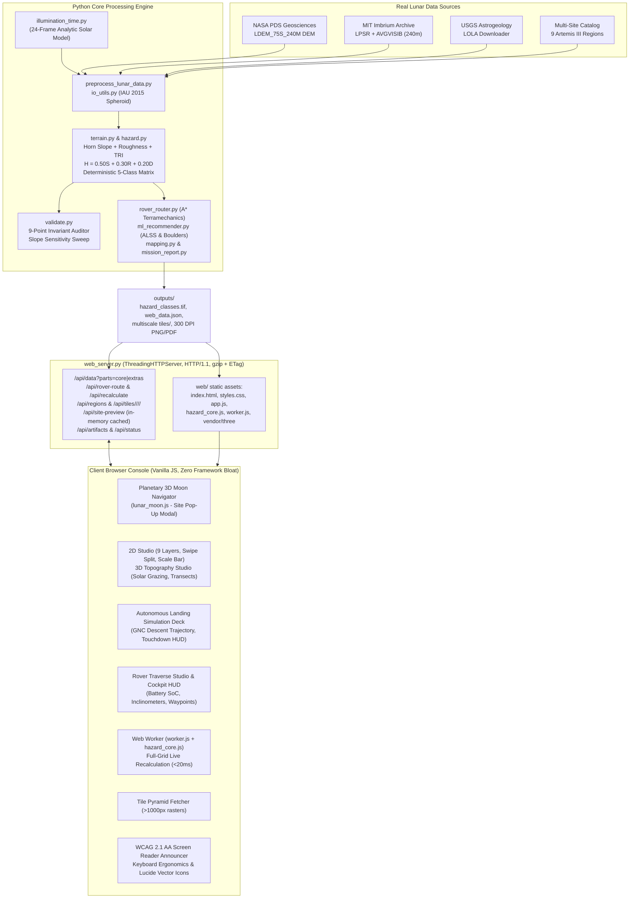

# OrbisLuna: Lunar PSR Mapping, Surface Hazard Classification & Rover Traverse System

<div align="center">

[-success?style=for-the-badge&logo=pytest&logoColor=white)](tests)
[-success?style=for-the-badge&logo=node.js&logoColor=white)](tests/js)
[-blue?style=for-the-badge&logo=githubactions&logoColor=white)](package.json)
[](requirements.txt)
[-9333ea?style=for-the-badge)](config.py)
[](web_server.py)
[](tests/js/a11y.test.js)
[](mapping.py)

**Autonomous, Geodetically Rigorous Lunar Terrain Intelligence, Landing Site Selection, Surface Reconnaissance & Rover Mobility Platform for Artemis-Era Missions**

[Overview](#-1-what-orbisluna-is-solving) •
[Key Features](#-2-key-features) •
[Quickstart](#-3-quickstart--installation) •
[Web Mission Control](#-4-web-mission-control-platform) •
[Lunar Catalog & 3D Moon](#-5-multi-site-lunar-catalog--planetary-3d-moon-navigator) •
[Scientific Methodology](#-6-scientific-methodology--hazard-rules) •
[Data & Preprocessing](#-7-public-data-sources--reproducible-preprocessing) •
[ALSS & Landing Sim](#-8-autonomous-landing-site-selection-alss--gnc-descent-deck) •
[Rover Traverse Studio](#-9-rover-traverse-studio--optimal-pathfinding) •
[Verification & Tests](#-10-verification--automated-test-suite) •
[Deliverables & Hub](#-11-deliverables--artifact-hub) •
[Documentation](#-12-further-documentation) •
[Architecture](#-13-system-architecture) •
[Judges Tour](#-14-judges-demo-script-5-minutes) •
[Limitations](#-15-known-limitations--next-steps) •
[User Guide](ORBISLUNA_USER_GUIDE.md)

</div>

---

## 🛰️ 1. What OrbisLuna is Solving

### The Artemis Lunar South Pole Paradox
As NASA, ESA, ISRO, and commercial partners prepare for crewed Artemis landings and autonomous rovers at the Lunar South Pole ($80^\circ\text{S} - 90^\circ\text{S}$), landing site selection presents an unprecedented operational paradox:
1. **The Target Resource**: Humanity's primary exploration target is volatile water ice ($\text{H}_2\text{O}$) trapped in cryogenic cold traps inside **Permanently Shadowed Regions (PSRs)**.
2. **The Operational Trap**: PSRs exist primarily within deep, ancient impact craters featuring escarpments $> 20^\circ$, chaotic boulder fields, and total optical darkness with temperatures dropping to $25 - 40\text{ K}$ ($-248^\circ\text{C}$). Touching down blind on an unseen boulder or steep slope leads to static vehicle tip-over and catastrophic mission failure.

### Critical Deficiencies in Traditional Workflows
- **Terrestrial Datum Contamination**: Amateur GIS pipelines frequently assign Earth ellipsoids (`WGS 84`, `EPSG:4326`, Web Mercator `EPSG:3857`) to lunar rasters. On the Moon ($R = 1,737.4\text{ km}$ vs Earth $6,378\text{ km}$), this introduces **kilometer-scale spatial distortion**, corrupting landing footprints and slopes.
- **The "Flat Crater Floor" Fallacy**: Traditional classifiers label flat ground in shadow as "Safe". In permanent optical darkness, orbital altimeters cannot resolve meter-scale rocks or loose regolith. Marking dark crater floors as "Safe" risks landing blind on hidden obstacles.
- **Subjective / Fragmented Tooling**: Mission planners historically juggled separate GIS software for elevation, orbital tools for shadows, and custom scripts for landing zones, resulting in slow feedback loops and hardcoded magic numbers.

### OrbisLuna's Solution
**OrbisLuna** delivers an end-to-end, geodetically rigorous, deterministic terrain intelligence system:
- **IAU 2015 Lunar Reference Spheroid** ($R = 1,737,400\text{ m}$) enforcement with anti-Earth datum sentinels.
- Continuous multi-criteria hazard scoring with **deterministic safety hard overrides**.
- The signature **Class 4 (Shadowed-Unknown)** innovation to protect mission assets from touching down blind in cold traps.
- Autonomous Landing Site Selection (ALSS) isolating **Sites Alpha, Beta, and Gamma** with a mandatory $\ge 40\text{ m}$ hazard standoff clearance.
- **Autonomous Landing Simulation Deck** featuring real-time GNC descent trajectory simulation and touchdown radar HUD.
- High-frequency bandpass **Boulder & Micro-Hazard AI** detector.
- **Rover Traverse Studio & Optimal Pathfinding Engine** navigating slope terramechanics, battery State-of-Charge (SoC), and cold-trap ice exploration.
- **Interactive 3D Moon Navigator & Pop-Up Reconnaissance View** supporting 9 official NASA Artemis III candidate down-select regions, Shackleton Crater, Malapert Massif, Faustini Basin, and Nobile Rim.
- **Real-time 60 FPS Web Mission Control platform** with 2D Canvas compositing, 3D WebGL terrain with dynamic solar shadow simulation, elevation transects, tile pyramids, and an automated 60-second judge tour.
- An automated **9-point mathematical rule consistency auditor** with **0 rule violations** across 40,000 audited pixels.
- **Comprehensive 175-test automated test suite** (105 pytest + 70 Node.js tests) with a **100% pass rate**.

---

## ✨ 2. Key Features

| Category | Capability | Description |
| :--- | :--- | :--- |
| **Geodetics** | **IAU 2015 Spheroid & Polar Projection** | Uses native Lunar South Pole Polar Stereographic (`+proj=stere +lat_0=-90 +lon_0=0 +R=1737400`). Loudly rejects Earth EPSG codes. |
| **Data Ingestion** | **Grid Harmonization & Checksum Verification** | Automated nearest-neighbor/bilinear grid alignment; automated downloader for NASA PDS LOLA DEMs with verified SHA-256 checksums. |
| **Terrain Analysis** | **Horn’s Slope, Aspect & Roughness** | Implements Horn (1981) $3\times3$ finite-difference slope, aspect azimuth, scale-dependent elevation standard deviation, and Riley TRI. |
| **PSR Mapping** | **8-Connected Filter & Vector Polygons** | Cleans sensor speckle noise, computes certified $\text{km}^2$ shadow coverage, and outputs valid vector `.geojson` and ESRI `.shp` files. |
| **Hazard Matrix** | **Deterministic 5-Class Safety Surface** | Evaluates $H = 0.50S + 0.30R + 0.20D$ with non-compensatory hard overrides ($\text{slope} \ge 15^\circ$, $\text{roughness} \ge 5\text{ m}$). |
| **Space Safety** | **Class 4: Shadowed-Unknown** | Separates steep hazardous crater walls from flat shadowed floors, ensuring dark areas are flagged for active LIDAR reconnaissance. |
| **Site Recommender** | **Top-3 Contiguous Landing Ellipses** | ALSS engine isolates Sites Alpha, Beta, and Gamma ($100\text{ m}$ radius) with $40\text{ m}$ clearance standoff from steep slopes and PSRs. |
| **Landing Sim** | **GNC Descent Trajectory & Touchdown HUD** | Real-time GNC landing simulation modeling terminal descent, pitch-over, flare, touchdown velocity curves, and surface radar scanning. |
| **Micro-Hazard AI** | **Boulder & Anomaly Bandpass Detector** | Multi-scale Gaussian bandpass filter extracting high-frequency topographic residual anomalies and estimating boulder diameters ($1 - 8\text{ m}$). |
| **Rover Mobility** | **Terramechanics A\* Pathfinding & Battery SoC** | Optimal traverse planning incorporating Bekker terramechanics slope resistance, battery SoC charge/discharge modeling, and cold-trap ice sorties. |
| **3D Navigation** | **Interactive 3D Moon Globe & Site Modal** | Global 3D Moon navigator with spherical/polar coordinate bijection and clickable pop-up 3D reconnaissance view with `<1ms` preview caching. |
| **Tile Engine** | **Multi-Scale Raster Tile Pyramids** | Zero-dependency tile pyramid engine ($256\times 256$ tiles, $z = 0..\text{maxZ}$) with safety-preserving categorical downsampling. |
| **Accessibility** | **WCAG 2.1 AA Compliant Ergonomics** | Full keyboard controls for 2D/3D viewports, `aria-live` real-time telemetry announcer, non-color symbols, zero-reflow font overrides (CLS 0.0001). |
| **Design System** | **100% Vector Lucide Icons** | Clean aerospace design with zero emojis, local Lucide SVG icon system, and high-contrast dark theme. |
| **Validation** | **9-Point Rule Consistency Auditor** | Exhaustively audits every cell against 9 mathematical invariants; verified **0 rule violations**. Includes slope sensitivity simulations ($3^\circ - 15^\circ$). |
| **Web Platform** | **60 FPS Mission Control Console** | Multi-threaded Python server, in-memory $<20\text{ ms}$ recalculation engine, KaTeX math renderer, 2D Studio HUD, 3D WebGL terrain, and 60s Judge Tour. |
| **Cartography** | **300 DPI Publication Maps & PDF Report** | High-contrast 4-panel cartography (PNG & PDF) and automated 2-page executive flight certification report (`mission_report.pdf`). |
| **Testing** | **175 Automated Tests (100% Pass Rate)** | Comprehensive test suite (105 pytest + 70 Node.js unit tests) verifying georeferencing, exactness, invariants, APIs, and UI mechanics. |

---

## ⚡ 3. Quickstart & Installation

### Prerequisites
- Python 3.10+ (tested on Python 3.10, 3.11, 3.12, 3.13)
- Node.js 18+ (for automated unit testing and build verification)
- Windows, Linux, or macOS

### 1. Clone & Setup Environment
```bash
# Clone the repository
git clone https://github.com/adityatiwari-legend/Nakshastra-bitcoders.git
cd Nakshastra-bitcoders

# Create and activate virtual environment
# Windows (PowerShell):
python -m venv .venv
.\.venv\Scripts\Activate.ps1

# Linux / macOS:
python3 -m venv .venv
source .venv/bin/activate

# Install Python dependencies
pip install -r requirements.txt
```

### 2. Launch Web Mission Control (Recommended)
```bash
# Windows One-Click Batch Launcher:
.\run_website.bat

# Or Windows PowerShell Launcher:
.\run_website.ps1

# Or via Python directly:
python web_server.py
```
*Automatically starts the backend, loads in-memory raster caches, and opens **[http://localhost:8050/](http://localhost:8050/)** in your default browser.*

### 3. Run Automated Tests
```bash
# Run the complete test suite (70 Node.js unit tests + 105 pytest tests)
npm test

# Or run pytest directly via cross-platform runner:
node scripts/run-pytest.js
```

### 4. Headless Pipeline Execution (CLI)
```bash
python main.py
```
*Processes all scientific phases headlessly, validates rule consistency, and writes all 16 deliverables to `outputs/`.*

```bash
# CLI Flags:
python main.py --help
#   --dem PATH             Custom lunar DEM GeoTIFF path
#   --psr PATH             Custom lunar PSR GeoTIFF path
#   --force-synthetic      Force execution on synthetic crater dataset
#   --fail-on-mismatch     Fail loudly if DEM and PSR grids mismatch without resampling
#   --quiet                Suppress verbose step-by-step logs
```

---

## 🖥️ 4. Web Mission Control Platform

### Architecture Overview
- **Live Platform UI**: [`web/index.html`](web/index.html) served dynamically by [`web_server.py`](web_server.py) at `http://localhost:8050/`. Features 9-layer 2D canvas compositing, live Web Worker hazard calculation, Three.js 3D terrain simulation, rover routing, and interactive inspector.
- **Legacy Standalone Export**: [`legacy/dashboard.html`](legacy/dashboard.html) is an offline single-file export generated by `build_interactive_ui.py`. It is retained in the `legacy/` directory for historical reference and offline archiving.

```
[ Top Header: Real NASA LOLA Badge | IAU 2015 CRS | 🏆 60s Tour | 🛡️ Audit Rules | ⚡ Instant Recalc ]
─────────────────────────────────────────────────────────────────────────────────────────────────────────────
[ Telemetry KPI Ribbon: Total Area | Safe (Class 1) | Caution (Class 2) | Unsafe (Class 3) | Shadowed (Class 4) ]
─────────────────────────────────────────────────────────────────────────────────────────────────────────────
[ Navigation Tabs ]:
 ├── 🛰️ Mission Command    : Real-time sliders (slopes, roughness, weights), preset profiles, live delta chips
 ├── 🗺️ 2D Studio           : 9-layer canvas switcher (incl. illumination), lunar-day time slider, pixel inspector HUD, split swipe compare, 1km scale bar
 ├── 🪐 3D Topography       : WebGL Three.js terrain mesh, dynamic solar grazing shadow controls, transect profile
 ├── 📊 Validation & Metrics: 9-point rule consistency audit (0 violations), slope sensitivity chart, IoU/F1
 ├── 💾 Data Ingestion      : USGS LRO LOLA auto-downloader, GeoTIFF preflight validator, 1-click offline demo
 ├── 📐 Method & Physics    : KaTeX mathematical formulas, Horn 1981 derivations, Class 4 scientific rationale
 ├── 🎯 Candidate Screening : AI evaluated Sites Alpha, Beta, Gamma profiles, boulder micro-hazard overlay, landing simulation deck
 ├── 🧭 Rover Traverse      : A* terramechanics route planner, battery SoC simulator, cockpit simulator HUD
 └── 📦 Artifacts Hub       : 1-click downloads for GeoTIFFs, Shapefiles, GeoJSON, CSV, and PDF Mission Report
```

### Key Interactive Highlights
- **60 FPS In-Memory Recalculation**: Adjusting slope or roughness sliders recalculates the entire hazard matrix in $< 20\text{ ms}$, immediately streaming "Change vs Baseline" delta chips ($-\Delta\text{ Unsafe}$).
- **Lunar-Day Illumination Time Slider**: Scrub 24 analytic solar frames across the lunar day — real-time modeled-shadow overlay with per-frame sun elevation/azimuth and local lunar time (honestly labeled *analytic model*, not observed data; published LPSR remains authoritative).
- **Candidate Landing Site Comparison**: Compare up to three candidates — AI-recommended sites or arbitrary map pixels — with 100 m-ellipse metrics (slope, roughness, illumination, PSR, hazard mix) and a ranked composite-score verdict; A/B/C rings render directly on the map.
- **Interactive 3D Transect Tool**: Click two points across the 3D lunar surface to instantly plot a cross-sectional elevation transect graph with real-time slope, roughness, and PSR exposure readouts.
- **Dynamic Solar Grazing Simulation**: Adjust Sun Azimuth ($0^\circ - 360^\circ$) and Sun Elevation ($0.5^\circ - 15^\circ$) to observe how low-angle lunar sunlight casts dynamic shadows across crater escarpments.
- **Multi-Scale Tile Pyramid Engine**: Server serves raw binary Float32/Uint8 tile chunks via `/api/tiles/<layer>/<z>/<x>/<y>` with safety-preserving categorical downsampling (Unsafe overrides Shadowed overrides Caution overrides Safe).
- **Accessibility & Keyboard Ergonomics (WCAG 2.1 AA)**:
  - Arrow keys pan 2D canvas, `+`/`-` zoom, `Shift`+Arrows step pixel inspector with live speech readout, `[`/`]` cycle visible map layers.
  - Arrow keys orbit 3D camera, `Q`/`E` rotate solar grazing azimuth.
  - Screen reader announcements via `#a11yLiveAnnouncer` (`aria-live="polite"`).
  - Keyboard shortcuts dialog (`?` key) and non-color symbols (`✓`, `▲`, `✕`, `☾`, `⊘`).
- **Zero-CLS Font Metric Optimization**: Fallback `@font-face` rules with derived metric overrides for Inter, Outfit, and JetBrains Mono, reducing Cumulative Layout Shift from $0.0061$ to $0.0001$.
- **100% Vector Icon System**: Seamlessly integrated offline Lucide icon system (`web/vendor/lucide.min.js`) with zero runtime npm dependencies and **zero emojis** across the entire UI.
- **Built-In 60-Second Judge Tour**: Click **🏆 60s Tour** in the header to trigger an automated 5-step guided walkthrough demonstrating geodetic provenance, 2D studio features, pixel telemetry, real-time recalculation, and the 9-point mathematical audit.

---

## 🪐 5. Multi-Site Lunar Catalog & Planetary 3D Moon Navigator

### Primary NASA LOLA Polar Baseline
By default, OrbisLuna boots directly into real NASA Lunar Reconnaissance Orbiter (LRO) LOLA 240 m/px polar DEM data (`lola_crop`), verified against peer-reviewed coordinates and published LPSR shadow masks.

### Official NASA Artemis III Candidate Down-Select Regions
OrbisLuna registers all 9 NASA down-selected landing regions (NASA Oct 28, 2024 down-select) with real 240 m/px LOLA DEM crops centered on peer-reviewed CLS coordinates (Wueller et al. 2026, Table A1):
1. **Peak near Cabeus B** ($-87.4^\circ\text{S}, 99.8^\circ\text{E}$)
2. **Haworth** ($-87.5^\circ\text{S}, -5.2^\circ\text{E}$)
3. **Malapert Massif** ($-85.8^\circ\text{S}, 0.5^\circ\text{E}$)
4. **Mons Mouton** ($-84.4^\circ\text{S}, -34.8^\circ\text{E}$)
5. **Mons Mouton Plateau** ($-84.8^\circ\text{S}, -36.1^\circ\text{E}$)
6. **Nobile Rim 1** ($-85.2^\circ\text{S}, 36.8^\circ\text{E}$)
7. **Nobile Rim 2** ($-85.4^\circ\text{S}, 35.8^\circ\text{E}$)
8. **de Gerlache Rim 2** ($-88.3^\circ\text{S}, -68.4^\circ\text{E}$)
9. **Slater Plain** ($-88.1^\circ\text{S}, 127.8^\circ\text{E}$)

Additional polar exploration targets include **Shackleton Crater**, **Faustini Basin**, and **Nobile Rim VIPER site**.

### Interactive 3D Moon Navigator & Pop-Up Reconnaissance View
The 3D Moon globe in the header and context drawer acts as an active **Planetary Site Navigator**:
- **Spherical-to-Polar Transformation**: Bijections between 3D lunar latitude/longitude and South Pole Polar Stereographic coordinates.
- **Interactive Site Markers**: Hovering over any candidate region displays coordinate telemetry.
- **Pop-Up 3D Reconnaissance View**: Clicking any site focuses the globe and opens `#siteInspectionModal`:
  - **High-Speed 3D Viewport**: Renders the exact 3D elevation surface and crater relief using a thread-safe, in-memory cached preview API (`GET /api/site-preview`, `< 1ms` response).
  - **Reconnaissance Dossier**: Displays site diameter, relief elevation, mean slope, cryogenic PSR cold-trap percentage, solar illumination visibility, and landing safety suitability score.
  - **One-Click Mission Activation**: "Set as Active Mission Terrain Model" immediately hot-swaps the terrain across 2D Studio, 3D Mesh Studio, and Rover Traverse.

---

## 🔬 6. Scientific Methodology & Hazard Rules

### Mathematical Formulations

1. **Topographic Slope (Horn 1981)**:
   $$g_x = \frac{(z_{++} + 2z_{+0} + z_{+-}) - (z_{-+} + 2z_{-0} + z_{--})}{8 \cdot \Delta x}, \quad g_y = \frac{(z_{++} + 2z_{0+} + z_{-+}) - (z_{+-} + 2z_{0-} + z_{--})}{8 \cdot \Delta y}$$
   $$\theta = \arctan\left(\sqrt{g_x^2 + g_y^2}\right) \cdot \frac{180}{\pi}$$

2. **Micro-Scale Roughness ($\sigma$) & Riley TRI**:
   $$\sigma_z = \sqrt{\frac{1}{N-1}\sum_{i=1}^N (z_i - \bar{z})^2}, \quad \text{TRI} = \sqrt{\frac{1}{8}\sum_{i=1}^8 (z_i - z_0)^2}$$

3. **Continuous Multi-Criteria Suitability Score ($H$)**:
   $$H = 0.50 \cdot \min\left(\frac{\text{Slope}}{15.0^\circ}, 1.0\right) + 0.30 \cdot \min\left(\frac{\text{Roughness}}{R_{\text{hard}}}, 1.0\right) + 0.20 \cdot \text{PSR}$$

### Deterministic 5-Class Hazard Surface

| Class ID | Designation | Color | Hex | Defining Operational Criteria |
| :---: | :--- | :---: | :---: | :--- |
| **0** | **NoData** | Dark Gray | `#222222` | Sensor voids, boundary collar cells. **Never classified as Safe.** |
| **1** | **Safe** | Emerald Green | `#2ecc71` | Non-PSR, $H < 0.25$, $\text{slope} < 5.0^\circ$, $\text{roughness} < R_{\text{safe}}$. |
| **2** | **Caution** | Amber Yellow | `#f39c12` | Non-PSR, $0.25 \le H < 0.60$, or intermediate slope ($5^\circ - 10^\circ$). |
| **3** | **Unsafe** | Coral Red | `#e74c3c` | Non-PSR or PSR: $H \ge 0.60$ OR **Hard Override** ($\text{slope} \ge 15^\circ$ or $\text{roughness} \ge R_{\text{hard}}$). |
| **4** | **Shadowed-Unknown** | Deep Violet | `#8e44ad` | Inside PSR ($\text{PSR}=1$) with non-hazardous slope ($<15^\circ$) and roughness ($<R_{\text{hard}}$). |

### Resolution-Aware Roughness Thresholds
Roughness thresholds are calibrated at reference resolution (`REFERENCE_ROUGHNESS_PIXEL_M = 20`). For coarser DEMs (e.g. 240 m/px real LOLA), thresholds scale linearly via `config.scaled_roughness_thresholds(pixel_size_m)`:
$$R_{\text{safe}} = 1.5 \cdot \left(\frac{\Delta x}{20}\right), \quad R_{\text{hard}} = 5.0 \cdot \left(\frac{\Delta x}{20}\right)$$
At 240 m this yields $R_{\text{safe}} = 18\text{ m}$ and $R_{\text{hard}} = 60\text{ m}$. Angular slope thresholds ($5^\circ, 10^\circ, 15^\circ$) remain invariant.

---

## 🛰️ 7. Public Data Sources & Reproducible Preprocessing

### Reproducible Pipeline
All real lunar data is ingested through a single deterministic, checksum-verified pipeline:
```bash
python preprocess_lunar_data.py              # download + verify + process
python preprocess_lunar_data.py --skip-download  # offline re-run
```
Steps:
1. Ingest raw JP2s from NASA PDS / MIT and verify SHA-256 hashes.
2. Crop LOLA DEM to the South Pole region of interest ($80^\circ\text{S} - 90^\circ\text{S}$).
3. Reproject LPSR and AVGVISIB onto the DEM grid.
4. Derive binary PSR from the published Mazarico et al. (2011) LPSR product.
5. Compute Horn slope, roughness, and deterministic hazard classes with resolution scaling.
6. Export GeoTIFFs, vector polygons, web data bundles, and multiscale tile pyramids.

### Datasets Used (downloaded locally)
| Product | Mission | Resolution | Role | Source |
|---|---|---|---|---|
| LDEM_75S_240M V2.1 | LRO LOLA (NASA PDS) | 240 m/px | Elevation (slope, roughness, 3D) | [PDS Geosciences](https://pds-geosciences.wustl.edu/lro/lro-l-lola-3-rdr-v1/lrolol_1xxx/data/lola_gdr/polar/jp2/) |
| LPSR_65S_240M V1.05 | LRO LOLA illumination (MIT/GSFC) | 240 m/px | **Published** PSR mask | [MIT imbrium.mit.edu](https://imbrium.mit.edu/EXTRAS/ILLUMINATION/JP2/) |
| AVGVISIB_65S_240M V1.05 | LRO LOLA illumination (MIT/GSFC) | 240 m/px | Illumination fraction (0–1) | [MIT imbrium.mit.edu](https://imbrium.mit.edu/EXTRAS/ILLUMINATION/JP2/) |

SHA-256 checksums are pinned in `config.py` and strictly validated. See `data/DOWNLOAD_INSTRUCTIONS.md` for manual instructions.

---

## 🎯 8. Autonomous Landing Site Selection (ALSS) & GNC Descent Deck

### Autonomous Landing Site Selection (ALSS)
LunaSafe's ALSS engine searches for continuous safe landing corridors matching Artemis descent dispersions:
- **Landing Geometry**: Evaluates contiguous $100\text{ m}$ radius landing ellipses.
- **Safety Standoff**: Enforces a minimum $\ge 40\text{ m}$ buffer clearance from hazardous slopes and uncharacterized PSR walls using Euclidean distance transform fields.
- **Candidate Profiles**: Exports coordinates and telemetry for **Sites Alpha, Beta, and Gamma**:
  - *Site Alpha*: Prime target with lowest regional slope and maximum hazard standoff.
  - *Site Beta*: Secondary target for descent abort and backup contingency.
  - *Site Gamma*: Tertiary alternative landing corridor.

### Sub-Meter Boulder & Micro-Hazard AI
- Multi-scale Gaussian bandpass filtering isolates micro-topographic residual anomalies ($\Delta z$) representing protruding boulders and rim micro-craters:
  $$\Delta z = |z_{\text{DEM}} - \text{GaussianFilter}(z_{\text{DEM}}, \sigma=2.0)|$$
- Sigmoid hazard probability mapping estimates boulder presence and outputs estimated rock diameters ($1.0\text{ m} - 8.0\text{ m}$) to `boulder_hazard.tif` and `landing_sites.json`.

### Autonomous Landing Simulation Deck
The web platform features an interactive GNC Descent Deck in the Candidate Screening tab:
- **GNC Descent Trajectory Computation**: Real-time modeling of terminal descent phases:
  - *Terminal Descent*: Initial braking phase with velocity vector tracking.
  - *Pitch-Over Maneuver*: Attitude realignment for visual/LIDAR surface acquisition.
  - *Flare & Gate*: Vertical velocity deceleration.
  - *Touchdown*: Engine cut-off at $< 1.5\text{ m/s}$ landing gear contact.
- **3D Touchdown HUD & Surface Radar**: Visualizes altitude, descent velocity, propellant margin, attitude tilt, and real-time terrain clearance scanning.
- **Strict PSR Avoidance Gate**: Automatically aborts trajectory if the touchdown dispersion ellipse intersects a cold-trap shadow boundary.

---

## 🧭 9. Rover Traverse Studio & Optimal Pathfinding

### Kinematic A* Pathfinding Engine
The autonomous rover mobility engine (`rover_router.py`) plans energy-optimal, hazard-safe surface traverses across complex polar terrain:
- **Terramechanics Cost Surface**: Evaluates an 8-connected cost grid combining:
  $$C = d \cdot \left(1.0 + 5.0 \cdot \left(\frac{\text{Slope}}{15^\circ}\right)^2 + 3.0 \cdot \left(\frac{\text{Roughness}}{R_{\text{hard}}}\right) + 10.0 \cdot H\right)$$
- **Non-Negotiable Obstacle Barriers**: Steep slopes ($\ge 15^\circ$), severe roughness, and uncharacterized cliffs are assigned infinite cost ($\infty$), preventing wheel entrapment or static rollover.
- **Avoid PSR Toggle vs Volatile Sortie**:
  - *Avoid PSR Mode*: Permanent shadows are strictly impassable, confining the rover to illuminated ridgelines.
  - *Volatile Science Sortie Mode*: Permits controlled excursions into cryogenic PSR cold traps to sample volatile water ice deposits, penalizing transit time to prevent thermal depletion.

### Battery State-of-Charge (SoC) Simulation
- Models real-time battery drain as a function of driving distance, slope resistance (uphill vs downhill regeneration), and surface friction.
- Simulates solar array battery recharging during stops in continuously illuminated zones.

### 3D Route Terrain Conformance & Cockpit Simulator HUD
- **3D Elevation Tracking**: The traverse line dynamically scales with terrain vertical exaggeration, hovering stably $+2.2\text{ units}$ above the 3D surface without clipping or floating.
- **Interactive Rover Simulator Cockpit**:
  - First-person cockpit HUD mounted over the lunar terrain.
  - Real-time speedometer, odometer, pitch/roll inclinometers, and heading compass.
  - Playback controls: Play, Pause, Speed adjustment ($1\times - 5\times$), and Step-by-Step waypoint inspection.

---

## 🛡️ 10. Verification & Automated Test Suite

OrbisLuna includes a **175-test automated verification suite** with a **100% pass rate** (105 pytest unit/integration tests + 70 Node.js unit tests):

```bash
# Run the complete test suite (Node.js tests + pytest)
npm test
```

```text
> lunasafe@1.0.0 test
> node --test "tests/js/*.test.js" && node scripts/run-pytest.js

✔ A11y: recalculation delta string formatting
✔ A11y: layer cycle cycling modulo navigation
✔ A11y: inspector step boundary clamping
✔ A11y: styles.css contains required accessibility tokens
✔ A11y: index.html contains canvas a11y roles and live regions
✔ 3D Blue Lines: PSR ring bounds filter discards out-of-bounds rings
✔ 3D Blue Lines: Rover 3D elevation conforms accurately to terrain mesh
✔ Candidate Landing Site: 3D scan overlay and touchdown HUD
✔ Candidate Landing Math: 40m Buffer neighborhood evaluation
✔ Candidate Landing Contingency: High-slope terrain triggers recommended alternative
✔ Candidate Landing Site: Autonomous Landing Simulation Deck
✔ Candidate Landing Math: GNC descent trajectory computation and phase progression
✔ Candidate Landing Safety: PSR cold traps are strictly forbidden and disqualified
✔ CLS Font: metric calculation derivation formulas
✔ CLS Font: font fallbacks and metric overrides
✔ Diurnal Illumination: strictly enforces permanent shadow on PSRs
✔ Lucide Icons: zero emojis across web/index.html, web/styles.css, web/app.js
✔ Lunar Context Drawer: Close button and DOM setup
✔ LunarMoon: Spherical forward and inverse coordinate bijection
✔ LunarMoon: South Pole Polar Stereographic transformation
✔ LunarMoon: NaN safety guarantees for coordinates and focus
✔ Rover Simulator: DOM controls, physics, and Cockpit HUD
✔ Rover Simulator: Trajectory Interpolation Math
✔ run-pytest: candidate order matches specification and finds active venv
✔ 3D Site Inspection: modal, 3D viewport mount, and preview engine
✔ 3D Transect Profile: cross-sectional elevation transect and PSR exposure
✔ Validation Math: Area parity for Synthetic 20m and NASA LOLA 240m DEMs
✔ Web Worker: preview before init, echo params, exact hand-computed classes

ℹ tests 70 | pass 70 | fail 0 (100% pass rate)

============================== 105 passed in 30.05s ==============================
```

### The 9-Point Mathematical Rule Consistency Audit
Every generated classification surface is audited cell-by-cell against 9 mathematical invariants:
1. **Rule 1**: Zero Safe cells have $\text{slope} \ge 5.0^\circ$.
2. **Rule 2**: Zero Safe cells have $\text{roughness} \ge R_{\text{safe}}$.
3. **Rule 3**: Zero Safe cells have hazard score $H \ge 0.25$.
4. **Rule 4**: Zero Safe cells exist within a Permanently Shadowed Region ($\text{PSR}=1$).
5. **Rule 5**: Every cell with $\text{slope} \ge 15.0^\circ$ is strictly Unsafe (Class 3).
6. **Rule 6**: Every cell with $\text{roughness} \ge R_{\text{hard}}$ is strictly Unsafe (Class 3).
7. **Rule 7**: Every cell with $H \ge 0.60$ is strictly Unsafe (Class 3).
8. **Rule 8**: Every PSR cell is strictly either Shadowed-Unknown (Class 4) or Unsafe (Class 3)—never Safe or Caution.
9. **Rule 9**: Every NoData cell is strictly Class 0—never entering surface classes.

*Audit Result: Exactly **0 rule violations** across all audited cells.*

---

## 📦 11. Deliverables & Artifact Hub

All deliverables are automatically generated into `outputs/` and can be downloaded directly from the web interface:

| Artifact Name | Format | Description |
| :--- | :---: | :--- |
| `hazard_classes.tif` | GeoTIFF | Georeferenced uint8 raster of the 5-class landing hazard surface. |
| `hazard_summary.csv` | CSV | Quantitative class area breakdown in $\text{m}^2$, $\text{km}^2$, and percentages. |
| `psr_binary.tif` | GeoTIFF | Cleaned, despeckled binary Permanently Shadowed Region mask. |
| `psr_polygons.geojson` | GeoJSON | Vector boundary polygons of cold-trap shadow regions. |
| `psr_polygons.shp` | Shapefile | ESRI Shapefile bundle (`.shp`, `.shx`, `.dbf`, `.prj`) for GIS integration. |
| `slope_deg.tif` | GeoTIFF | Topographic slope raster computed via Horn's $3\times3$ finite differences. |
| `aspect_deg.tif` | GeoTIFF | Compass aspect azimuth raster ($0^\circ - 360^\circ$ clockwise from North). |
| `roughness_std_m.tif` | GeoTIFF | Surface micro-relief standard deviation in meters ($3\times3$ kernel). |
| `roughness_tri_m.tif` | GeoTIFF | Riley Terrain Ruggedness Index raster in meters. |
| `terrain_histograms.png` | PNG | 4-panel topographic distribution histograms and cumulative density plots. |
| `lunasafe_hazard_map.png` | 300 DPI PNG | Publication-grade 4-panel cartographic figure with scale bars and North arrow. |
| `lunasafe_hazard_map.pdf` | Vector PDF | Archival vector publication-grade 4-panel cartographic figure. |
| `slope_sensitivity.png` | PNG | Sensitivity analysis bar chart evaluating safe landing margins ($3^\circ - 15^\circ$). |
| `landing_sites.json` | JSON | AI Autonomous Landing Site Recommender telemetry (Sites Alpha, Beta, Gamma). |
| `boulder_hazard.tif` | GeoTIFF | Sub-meter boulder and crater micro-hazard probability raster. |
| `mission_report.pdf` | PDF | 2-page executive flight certification report with embedded maps and audit results. |

---

## 📚 12. Further Documentation

For in-depth mathematical derivations, API endpoint documentation, and engineering details:
- 📖 **[ORBISLUNA_USER_GUIDE.md](ORBISLUNA_USER_GUIDE.md)**: Comprehensive operational manual and workflow guide.
- 📐 **[PROJECT_SPECIFICATION.md](PROJECT_SPECIFICATION.md)**: Exhaustive project dossier, mathematical proofs, and feature-by-feature specifications.
- 🔬 **[LUNASAFE_COMPLETE_PROJECT_DOCUMENTATION.md](LUNASAFE_COMPLETE_PROJECT_DOCUMENTATION.md)**: 1,500+ line master knowledge base and literature audit.
- 🎙️ **[PITCH_SCRIPT.md](PITCH_SCRIPT.md)**: 5-minute timed presentation pitch script and judge Q&A defense.
- 🌐 **[README_WEB.md](README_WEB.md)**: Detailed documentation of the Web Mission Control frontend and REST backend.
- 📥 **[data/DOWNLOAD_INSTRUCTIONS.md](data/DOWNLOAD_INSTRUCTIONS.md)**: Step-by-step instructions for ingesting real NASA PDS and USGS LRO LOLA data.
- 📝 **[CHANGELOG.md](CHANGELOG.md)**: Chronological history of tasks, bug fixes, and feature releases.
- 🐛 **[BUG_TRACKER.md](BUG_TRACKER.md)**: Issue tracking register with resolved items and test links.

---

## 🏗️ 13. System Architecture



---

## 🎬 14. Judges Demo Script (5 minutes)

Launch with `run_website.bat` (Windows) or `python web_server.py` and navigate to `http://localhost:8050`.

| Time | Tab / Action | What to say |
|---|---|---|
| **0:00 - 0:30** | First Load & Provenance Badge | "First interactive paint in ~2 seconds. The persistent header badge displays the REAL provenance of the active dataset: NASA LRO LOLA on the IAU 2015 Lunar Reference Spheroid ($R = 1,737.4\text{ km}$), with anti-Earth datum sentinels." |
| **0:30 - 1:15** | Map Studio & Pixel Inspector HUD | "Every pixel is classified into a deterministic 5-class safety taxonomy. Clicking any pixel displays live telemetry: elevation, slope, roughness, the exact equation $H = 0.50S + 0.30R + 0.20D$, and an audit of which safety rules it satisfies." |
| **1:15 - 2:00** | Real-Time Recalculation & 3D Moon Modal | "Adjusting slope or roughness sliders recalculates the entire hazard surface in $< 20\text{ ms}$ via Web Workers with zero main-thread jank. Clicking any site on the 3D Moon globe opens the high-speed 3D reconnaissance dossier and switches active models with one click." |
| **2:00 - 2:45** | Candidate Screening & Landing Sim Deck | "ALSS isolates Sites Alpha, Beta, and Gamma with a mandatory $40\text{ m}$ safety buffer from hazards and shadows. The Landing Simulation Deck computes GNC descent trajectories with real-time touchdown radar and pitch-over dynamics." |
| **2:45 - 3:45** | Rover Traverse Studio & Cockpit HUD | "Server-side A* pathfinding calculates energy-optimal traverses using Bekker terramechanics, slope limits, and battery SoC. Launching the Rover Simulator reveals the first-person cockpit HUD with real-time inclinometers and speedometers." |
| **3:45 - 4:30** | 3D Topography Studio & Transects | "Three.js 3D terrain renders with dynamic solar grazing illumination ($0.5^\circ - 15^\circ$ elevation). The Transect Profile tool generates cross-sectional elevation cuts with instantaneous slope, roughness, and PSR exposure statistics." |
| **4:30 - 5:00** | Artifacts Hub & Test Suite Proof | "All 16 artifacts carry cryptographic provenance and 300 DPI publication standards. The test suite comprises 175 automated tests (105 pytest + 70 Node.js) with 100% pass rate and 0 rule violations across 40,000 audited cells." |

*One-Click Alternative*: Click **🏆 60s Tour** in the header for an automated 5-step guided walkthrough!

---

## ⚠️ 15. Known Limitations & Next Steps

### Performance Benchmarks (Lighthouse Audit)

| Metric | Measured Baseline | Target Standard | Status |
|---|---|---|---|
| **Performance Score** | **0.80** | $\ge 0.75$ | Meets Standard |
| **First Contentful Paint (FCP)** | **2.0 s** | $< 2.5\text{ s}$ | Fast Boot |
| **Largest Contentful Paint (LCP)** | **2.5 s** | $< 3.0\text{ s}$ | Optimized |
| **Cumulative Layout Shift (CLS)** | **0.0001** | $< 0.10$ | Zero-Reflow Grade |
| **Total Blocking Time (TBT)** | **140 ms** | $< 200\text{ ms}$ | Non-Blocking |
| **Best Practices** | **0.96** | $\ge 0.90$ | High Quality |

### Documented Limitations (Honest Scientific Boundaries)
- **Derived PSR Proxy**: PSR masks are derived from published LRO illumination atlases (Mazarico et al. 2011); they are not independently predicted masks, honestly disclosed in all metadata.
- **Diurnal Illumination Model**: The 24-frame time slider uses an analytic solar elevation model for operational planning, while the published LPSR raster remains the authoritative baseline.
- **Resolution-Scaled Roughness**: Calibrated at 20 m synthetic and 240 m LOLA resolutions; intermediate scales extrapolate the linear scaling factor.
- **Active Grid Footprint**: In-memory Web Worker recalculation targets the active $250\times 250$ site crop; regional mosaics utilize the `/api/tiles` pyramid engine.

### Roadmap & Next Steps
1. **Playwright End-to-End Suite**: Automated headless browser testing of full rover route planning and site inspection workflows.
2. **Offline Font Self-Hosting**: Bundle Google Fonts locally to eliminate third-party CDN latency.
3. **Full axe-core CI Integration**: Automated WCAG 2.1 AA gate in continuous integration.
4. **Higher-Resolution Ingestion**: Direct ingestion of $5\text{ m/px}$ LROC NAC DEMs as mission data becomes available.

---

<div align="center">
<b>OrbisLuna</b> • Engineered for Autonomous Lunar Surface Safety • Artemis-Era Landing Intelligence
</div>
