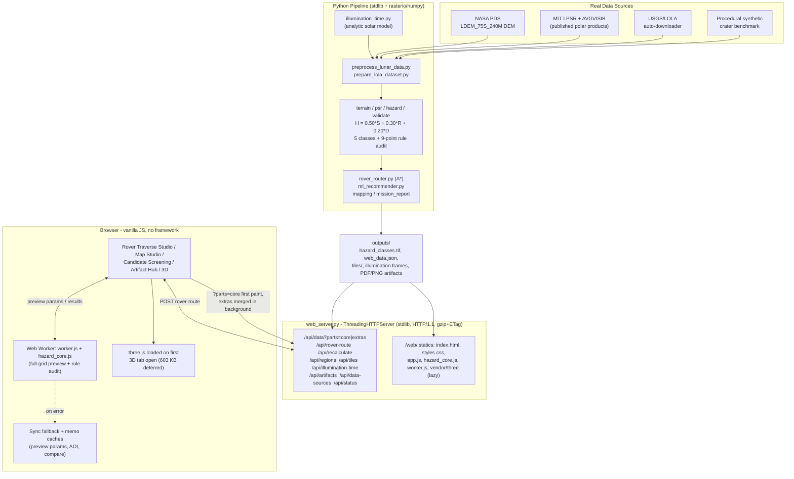

# OrbisLuna: Lunar PSR Mapping, Surface Hazard Classification & Rover Traverse System

<div align="center">

[-success?style=for-the-badge&logo=pytest&logoColor=white)](tests)
[-success?style=for-the-badge&logo=node.js&logoColor=white)](tests/js)
[](requirements.txt)
[-9333ea?style=for-the-badge)](config.py)
[](web_server.py)
[](mapping.py)

**Autonomous, Geodetically Rigorous Lunar Terrain Intelligence, Landing Site Selection & Rover Mobility Platform for Artemis-Era Missions**

[Overview](#-1-what-orbisluna-is-solving) •
[Key Features](#-2-key-features) •
[Quickstart](#-3-quickstart--installation) •
[Web Mission Control](#-4-web-mission-control-platform) •
[Rover Traverse Studio](#-5-rover-traverse--optimal-routing) •
[Lunar Site Models](#-6-multi-site-lunar-catalog) •
[Scientific Methodology](#-7-scientific-methodology--hazard-rules) •
[ALSS & Boulder AI](#-8-autonomous-landing-site-recommender--boulder-ai) •
[Verification & Tests](#-9-verification--automated-test-suite) •
[User Guide](ORBISLUNA_USER_GUIDE.md)

</div>

---

## 🛰️ 1. What OrbisLuna is Solving

### The Artemis Lunar South Pole Paradox
As NASA, ESA, ISRO, and commercial partners prepare for crewed Artemis landings and autonomous rovers at the Lunar South Pole ($80^\circ\text{S} - 90^\circ\text{S}$), landing site selection presents an unprecedented operational paradox:
1. **The Target Resource**: Humanity's primary exploration target is water ice ($\text{H}_2\text{O}$) trapped in cryogenic cold traps inside **Permanently Shadowed Regions (PSRs)**.
2. **The Operational Trap**: PSRs exist inside steep impact craters featuring escarpments $> 20^\circ$, chaotic boulder fields, and total optical darkness with temperatures dropping to $25 - 40\text{ K}$. Touching down on an unseen boulder or steep slope leads to static vehicle tip-over and catastrophic mission failure.

### Critical Deficiencies in Traditional Workflows
- **Terrestrial Datum Contamination**: Amateur GIS pipelines frequently assign Earth ellipsoids (`WGS 84`, `EPSG:4326`, Web Mercator) to lunar data. On the Moon ($R = 1,737.4\text{ km}$ vs Earth $6,378\text{ km}$), this introduces **kilometer-scale spatial distortion**, invalidating slope and landing ellipse safety.
- **The "Flat Crater Floor" Fallacy**: Traditional classifiers label flat ground in shadow as "Safe". In permanent optical darkness, orbital altimeters cannot resolve meter-scale rocks or loose regolith. Marking dark crater floors as "Safe" risks landing blind on hidden obstacles.
- **Subjective / Fragmented Tooling**: Mission planners historically juggled separate GIS software for elevation, orbital tools for shadows, and custom scripts for landing zones, resulting in slow feedback loops and hardcoded magic numbers.

### OrbisLuna's Solution
**OrbisLuna** delivers an end-to-end, geodetically rigorous, deterministic terrain intelligence system:
- Strict geodetic enforcement on the **IAU 2015 Lunar Sphere** ($R = 1,737,400\text{ m}$) with anti-Earth datum sentinels.
- Continuous multi-criteria hazard scoring with **deterministic safety hard overrides**.
- The signature **Class 4 (Shadowed-Unknown)** innovation to protect mission assets from touching down blind.
- Autonomous Landing Site Selection (ALSS) ranking **Top-3 Landing Ellipses (Alpha, Beta, Gamma)** with hazard standoff clearance.
- High-frequency bandpass **Boulder & Micro-Hazard AI** detector.
- **Rover Traverse & Optimal Pathfinding Engine** navigating slope terramechanics, battery SoC, and cold-trap ice exploration.
- **Multi-Site Lunar Catalog** supporting Shackleton Crater, Malapert Mountain, Faustini Basin, Nobile Rim VIPER site, and synthetic benchmarks.
- A **real-time 60 FPS Web Mission Control platform** with 2D Canvas compositing, 3D WebGL terrain with dynamic solar shadow simulation, elevation transects, and an automated 60-second judge tour.
- An automated **9-point mathematical rule consistency auditor** with **0 rule violations** across 40,000 audited pixels.

---

## ✨ 2. Key Features

| Category | Capability | Description |
| :--- | :--- | :--- |
| **Geodetics** | **IAU 2015 Spheroid & Polar Projection** | Uses native Lunar South Pole Polar Stereographic (`+proj=stere +lat_0=-90 +lon_0=0 +R=1737400`). Loudly rejects Earth EPSG codes. |
| **Data Ingestion** | **Grid Harmonization & Synthetic Generator** | Automated nearest-neighbor/bilinear grid alignment; includes procedural synthetic crater benchmark and USGS LOLA auto-downloader. |
| **Terrain Analysis** | **Horn’s Slope, Aspect & Roughness** | Implements Horn (1981) $3\times3$ finite-difference slope, aspect azimuth, scale-dependent elevation standard deviation, and Riley TRI. |
| **PSR Mapping** | **8-Connected Filter & Vector Polygons** | Cleans sensor speckle noise, computes certified $\text{km}^2$ shadow coverage, and outputs valid vector `.geojson` and ESRI `.shp` files. |
| **Hazard Matrix** | **Deterministic 5-Class Safety Surface** | Evaluates $H = 0.50S + 0.30R + 0.20D$ with non-compensatory hard overrides ($\text{slope} \ge 15^\circ$, $\text{roughness} \ge 5\text{ m}$). |
| **Space Safety** | **Class 4: Shadowed-Unknown** | Separates steep hazardous crater walls from flat shadowed floors, ensuring dark areas are flagged for active LIDAR reconnaissance. |
| **Site Recommender** | **Top-3 Contiguous Landing Ellipses** | ALSS engine isolates Sites Alpha, Beta, and Gamma ($100\text{ m}$ radius) with $40\text{ m}$ clearance standoff from steep slopes and PSRs. |
| **Micro-Hazard AI** | **Boulder & Anomaly Bandpass Detector** | Multi-scale Gaussian bandpass filter extracting high-frequency topographic residual anomalies and estimating boulder diameters ($1 - 8\text{ m}$). |
| **Validation** | **9-Point Rule Consistency Auditor** | Exhaustively audits every cell against 9 mathematical invariants; verified **0 rule violations**. Includes slope sensitivity simulations ($3^\circ - 15^\circ$). |
| **Web Platform** | **60 FPS Mission Control Console** | Multi-threaded Python server, in-memory $<20\text{ ms}$ recalculation engine, KaTeX math renderer, 2D Studio HUD, 3D WebGL terrain, and 60s Judge Tour. |
| **Cartography** | **300 DPI Publication Maps & PDF Report** | High-contrast 4-panel cartography (PNG & PDF) and automated 2-page executive flight certification report (`mission_report.pdf`). |
| **Testing** | **86 Automated Tests** | Comprehensive pytest test suite covering georeferencing, exactness, invariants, live API endpoints, and edge cases with 100% pass rate. |

---

## ⚡ 3. Quickstart & Installation

### Prerequisites
- Python 3.10+ (tested on Python 3.10, 3.11, 3.12, 3.13)
- Windows, Linux, or macOS

### 1. Clone & Setup Environment
```bash
# Clone the repository
git clone https://github.com/kushbansal2005/ORBISLUNA.git
cd LunaSafe

# Create and activate virtual environment
# Windows (PowerShell):
python -m venv .venv
.\.venv\Scripts\Activate.ps1

# Linux / macOS:
python3 -m venv .venv
source .venv/bin/activate

# Install dependencies
pip install -r requirements.txt
```

### 2. Launch Web Mission Control (Recommended)
```bash
# Windows One-Click:
.\run_website.bat
# Or via Python:
python web_server.py
```
*Automatically starts the backend, loads in-memory raster caches, and opens **[http://localhost:8050/](http://localhost:8050/)** in your default browser.*

### 3. Headless Pipeline Execution (CLI)
```bash
python main.py
```
*Processes all scientific phases headlessly, validates rule consistency, and writes all 15 deliverables to `outputs/`.*

```bash
# CLI Flags:
python main.py --help
#   --dem PATH             Custom lunar DEM GeoTIFF path
#   --psr PATH             Custom lunar PSR GeoTIFF path
#   --force-synthetic      Force execution on synthetic crater dataset
#   --fail-on-mismatch     Fail loudly if DEM and PSR grids mismatch without resampling
#   --quiet                Suppress verbose step-by-step logs
```

---

## 🖥️ 4. Web Mission Control Platform

### 🧭 Which file is the live UI?
- **Live Platform UI**: [`web/index.html`](web/index.html) served dynamically by [`web_server.py`](web_server.py) at `http://localhost:8050/`. Features 9-layer 2D canvas compositing, live Web Worker hazard calculation, Three.js 3D terrain simulation, rover routing, and interactive inspector.
- **Legacy Standalone Export**: [`legacy/dashboard.html`](legacy/dashboard.html) is an offline single-file export generated by `build_interactive_ui.py`. It is retained in the `legacy/` directory for historical reference and offline archiving, but is not part of the active web application runtime.

```
[ Top Header: Persistent Provenance Badge | IAU 2015 CRS | 🏆 60s Tour | 🛡️ Audit Rules | ⚡ Instant Recalc ]
─────────────────────────────────────────────────────────────────────────────────────────────────────────────
[ Telemetry KPI Ribbon: Total Area | Safe (Class 1) | Caution (Class 2) | Unsafe (Class 3) | Shadowed (Class 4) ]
─────────────────────────────────────────────────────────────────────────────────────────────────────────────
[ Navigation Tabs ]:
 ├── 🛰️ Mission Command    : Real-time sliders (slopes, roughness, weights), preset profiles, live delta chips
 ├── 🗺️ 2D Studio           : 9-layer canvas switcher (incl. illumination), lunar-day time slider, pixel inspector HUD, split swipe compare, 1km scale bar
 ├── 🪐 3D Topography       : WebGL Three.js terrain mesh, dynamic solar grazing shadow controls, transect profile
 ├── 📊 Validation & Metrics: 9-point rule consistency audit (0 violations), slope sensitivity chart, IoU/F1
 ├── 💾 Data Ingestion      : USGS LRO LOLA auto-downloader, GeoTIFF preflight validator, 1-click offline demo
 ├── 📐 Method & Physics    : KaTeX mathematical formulas, Horn 1981 derivations, Class 4 scientific rationale
 ├── 🎯 Candidate Screening : AI evaluated Sites Alpha, Beta, Gamma profiles, boulder micro-hazard overlay
 └── 📦 Artifacts Hub       : 1-click downloads for GeoTIFFs, Shapefiles, GeoJSON, CSV, and PDF Mission Report
```

### Key Interactive Highlights
- **60 FPS In-Memory Recalculation**: Adjusting slope or roughness sliders recalculates the entire hazard matrix in $< 20\text{ ms}$, immediately streaming "Change vs Baseline" delta chips ($-\Delta\text{ Unsafe}$).
- **Lunar-Day Illumination Time Slider**: Scrub 24 analytic solar frames across the lunar day — real-time modeled-shadow overlay with per-frame sun elevation/azimuth and local lunar time (honestly labeled *analytic model*, not observed data; published LPSR remains authoritative).
- **Landing-Site Comparison**: Compare up to three candidates — AI-recommended sites or arbitrary map pixels — with 100 m-ellipse metrics (slope, roughness, illumination, PSR, hazard mix) and a ranked composite-score verdict; A/B/C rings render directly on the map.
- **Shareable URL State**: tab, tool, active site, layer visibility/opacity, map view, selected pixel, swipe split, time frame, and comparison set are all encoded in the URL — deep links, refresh, and back/forward restore the exact session.
- **Interactive 3D Transect Tool**: Click two points across the 3D lunar surface to instantly plot a cross-sectional elevation transect graph with real-time slope and roughness readouts.
- **Dynamic Solar Grazing Simulation**: Adjust Sun Azimuth ($0^\circ - 360^\circ$) and Sun Elevation ($0.5^\circ - 15^\circ$) to observe how low-angle lunar sunlight casts dynamic shadows across crater escarpments.
- **Built-In 60-Second Judge Tour**: Click **🏆 60s Tour** in the header to trigger an automated 5-step guided walkthrough demonstrating geodetic provenance, 2D studio features, pixel telemetry, real-time recalculation, and the 9-point mathematical audit.
- **100% Offline Demo Mode**: Click **"Load Offline Demo"** to instantaneously load precomputed deliverables from `outputs/` without any external network dependency.

---

## 🔬 5. Scientific Methodology & Hazard Rules

### Mathematical Formulations

1. **Topographic Slope (Horn 1981)**:
   $$g_x = \frac{(z_{++} + 2z_{+0} + z_{+-}) - (z_{-+} + 2z_{-0} + z_{--})}{8 \cdot \Delta x}, \quad g_y = \frac{(z_{++} + 2z_{0+} + z_{-+}) - (z_{+-} + 2z_{0-} + z_{--})}{8 \cdot \Delta y}$$
   $$\theta = \arctan\left(\sqrt{g_x^2 + g_y^2}\right) \cdot \frac{180}{\pi}$$

2. **Micro-Scale Roughness ($\sigma$) & Riley TRI**:
   $$\sigma_z = \sqrt{\frac{1}{N-1}\sum_{i=1}^N (z_i - \bar{z})^2}, \quad \text{TRI} = \sqrt{\frac{1}{8}\sum_{i=1}^8 (z_i - z_0)^2}$$

3. **Continuous Multi-Criteria Suitability Score ($H$)**:
   $$H = 0.50 \cdot \min\left(\frac{\text{Slope}}{15.0^\circ}, 1.0\right) + 0.30 \cdot \min\left(\frac{\text{Roughness}}{5.0\text{ m}}, 1.0\right) + 0.20 \cdot \text{PSR}$$

### Deterministic 5-Class Hazard Surface

| Class ID | Designation | Color | Hex | Defining Operational Criteria |
| :---: | :--- | :---: | :---: | :--- |
| **0** | **NoData** | Dark Gray | `#222222` | Sensor voids, boundary collar cells. **Never classified as Safe.** |
| **1** | **Safe** | Emerald Green | `#2ecc71` | Non-PSR, $H < 0.25$, $\text{slope} < 5.0^\circ$, $\text{roughness} < 1.5\text{ m}$. |
| **2** | **Caution** | Amber Yellow | `#f39c12` | Non-PSR, $0.25 \le H < 0.60$, or intermediate slope ($5^\circ - 10^\circ$). |
| **3** | **Unsafe** | Coral Red | `#e74c3c` | Non-PSR or PSR: $H \ge 0.60$ OR **Hard Override** ($\text{slope} \ge 15^\circ$ or $\text{roughness} \ge 5\text{ m}$). |
| **4** | **Shadowed-Unknown** | Deep Violet | `#8e44ad` | Inside PSR ($\text{PSR}=1$) with non-hazardous slope ($<15^\circ$) and roughness ($<5\text{ m}$). |

---

## 🛰️ 5b. Public Data Sources, Artemis III Regions & Preprocessing

### Reproducible Pipeline
All real lunar data is ingested through a single deterministic, checksum-verified pipeline:

```bash
.venv/Scripts/python.exe preprocess_lunar_data.py              # download + verify + process
.venv/Scripts/python.exe preprocess_lunar_data.py --skip-download  # offline re-run
```

Steps: (1) download raw JP2s from NASA PDS / MIT if missing and verify SHA-256, (2) crop the LOLA DEM to the south-pole ROI, (3) reproject LPSR + AVGVISIB onto the DEM grid, (4) derive binary PSR from the **published** Mazarico et al. (2011) LPSR product (never a DEM-threshold proxy), (5) compute illumination fraction, (6) compute slope/roughness and classify hazard with resolution-scaled roughness thresholds, (7) export GeoTIFFs + web-ready compact JSON / GeoJSON / XYZ tiles.

### Datasets Used (downloaded locally)
| Product | Mission | Resolution | Role | Source |
|---|---|---|---|---|
| LDEM_75S_240M V2.1 | LRO LOLA (NASA PDS) | 240 m/px | Elevation (slope, roughness, 3D) | [PDS Geosciences](https://pds-geosciences.wustl.edu/lro/lro-l-lola-3-rdr-v1/lrolol_1xxx/data/lola_gdr/polar/jp2/) |
| LPSR_65S_240M V1.05 | LRO LOLA illumination (MIT/GSFC) | 240 m/px | **Published** PSR mask | [MIT imbrium.mit.edu](https://imbrium.mit.edu/EXTRAS/ILLUMINATION/JP2/) |
| AVGVISIB_65S_240M V1.05 | LRO LOLA illumination (MIT/GSFC) | 240 m/px | Illumination fraction (0–1) | [MIT imbrium.mit.edu](https://imbrium.mit.edu/EXTRAS/ILLUMINATION/JP2/) |

SHA-256 checksums for all three JP2s are pinned in `config.py` and verified on every run. See `data/DOWNLOAD_INSTRUCTIONS.md` for manual download steps.

### Documented-Only Datasets (not bundled; access steps in `config.PUBLIC_DATASETS`)
- **Diviner Lunar Radiometer** polar temperatures — NASA PDS PPI (UCLA). Not required for hazard classes; no single canonical polar file exists.
- **Chandrayaan-2 OHRC / TMC-2** (ISRO PRADAN) — registration + approval required; cannot be fetched anonymously.
- **Moon Trek** (trek.nasa.gov) — visualization portal, not a bulk-download API; used for manual context only.
- **LROC NAC_PS Pole PSR shapefile** — 403 to scripts; MIT LPSR raster is the primary PSR source in LunaSafe.

### Official Artemis III Candidate Regions (NASA Oct 28, 2024 down-select)
Nine regions are registered as catalog sites (`artemis_*`) with real 240 m/px LOLA DEM crops centered on peer-reviewed CLS coordinates (Wueller et al. 2026, Table A1):

Peak near Cabeus B · Haworth · Malapert Massif · Mons Mouton · Mons Mouton Plateau · Nobile Rim 1 · Nobile Rim 2 · de Gerlache Rim 2 · Slater Plain

Each region's PSR mask comes from the published Mazarico LPSR product — LunaSafe never labels published PSR as an "independently predicted" mask.

### Resolution-Aware Roughness Thresholds
Roughness thresholds were originally calibrated at the 20 m synthetic reference resolution (`REFERENCE_ROUGHNESS_PIXEL_M = 20`). For coarser DEMs (e.g. 240 m/px real LOLA), thresholds scale linearly with pixel size via `config.scaled_roughness_thresholds(pixel_size_m)` — at 240 m this yields Safe <18 m, hard-Unsafe ≥60 m. Slope thresholds (angular) are not scaled. All classification, validation, rover-cost, and web-export paths pass the active pixel size so the rules stay consistent everywhere.

---

## 🎯 6. Autonomous Landing Site Recommender & Boulder AI

### Autonomous Landing Site Selection (ALSS)
LunaSafe's ALSS engine searches for continuous safe landing corridors matching Artemis descent dispersions:
- **Landing Geometry**: Evaluates contiguous $100\text{ m}$ radius landing ellipses.
- **Safety Standoff**: Enforces a minimum $40\text{ m}$ buffer clearance from hazardous slopes and uncharacterized PSR walls using Euclidean distance transform fields.
- **Candidate Profiles**: Exports coordinates and telemetry for **Sites Alpha, Beta, and Gamma**:
  - *Site Alpha*: Prime target with lowest regional slope and maximum hazard standoff.
  - *Site Beta*: Secondary target for descent abort and backup contingency.
  - *Site Gamma*: Tertiary alternative landing corridor.

### Sub-Meter Boulder & Micro-Hazard AI
- Multi-scale Gaussian bandpass filtering isolates micro-topographic residual anomalies ($\Delta z$) representing protruding boulders and rim micro-craters invisible to standard low-pass slope gradients.
- Sigmoid hazard probability mapping estimates boulder presence and outputs estimated rock diameters ($1.0\text{ m} - 8.0\text{ m}$) to `boulder_hazard.tif` and `landing_sites.json`.

---

## 🛡️ 7. Verification & Automated Test Suite

LunaSafe includes a comprehensive 126-test automated verification suite (96 pytest + 30 Node.js unit tests spanning georeferencing, multi-scale tile pyramids, hazard rules, PSR exactness, preprocessing, artifacts, live API endpoints, accessibility, and zero-reflow font metric overrides):

```bash
# Run complete cross-platform test suite (Node tests + pytest)
npm test

# Run pytest directly with automatic interpreter resolution
node scripts/run-pytest.js
```

```text
============================= test session starts =============================
platform win32 -- Python 3.13.0, pytest-9.1.1, pluggy-1.6.0 -- E:\sistec\LunaSafe\.venv\Scripts\python.exe
rootdir: E:\sistec\LunaSafe
collected 86 items

tests/test_artifacts.py::test_manifest_scans_outputs_and_skips_internals PASSED [  1%]
tests/test_artifacts.py::test_manifest_includes_saved_routes_with_hub_metadata PASSED [  2%]
tests/test_artifacts.py::test_artifact_entry_rejects_sidecars_and_bad_extensions PASSED [  3%]
tests/test_hazard.py::test_hazard_score_formula_and_normalization PASSED [  5%]
tests/test_hazard.py::test_hard_overrides_trigger_class_3_unsafe PASSED  [  6%]
tests/test_hazard.py::test_shadowed_unknown_vs_unsafe_psr PASSED         [  7%]
tests/test_hazard.py::test_safe_and_caution_classification PASSED        [  8%]
tests/test_hazard.py::test_nodata_is_never_treated_as_safe PASSED        [ 10%]
tests/test_hazard.py::test_process_hazard_pipeline_end_to_end PASSED     [ 11%]
tests/test_hazard.py::test_known_grid_exact_class_map PASSED             [ 11%]
tests/test_main.py::test_main_pipeline_execution PASSED                  [ 12%]
tests/test_mapping.py::test_hillshade_computation PASSED                 [ 13%]
tests/test_mapping.py::test_generate_4panel_hazard_map_end_to_end PASSED [ 15%]
tests/test_mission_report.py::test_mission_report_generates_hermetically PASSED [ 16%]
tests/test_mission_report.py::test_mission_report_provenance_uses_hazard_tags PASSED [ 17%]
tests/test_mission_report.py::test_mission_report_no_fabricated_fallback_stats PASSED [ 18%]
tests/test_ml_recommender.py::test_boulder_micro_hazard_detection PASSED [ 20%]
tests/test_ml_recommender.py::test_landing_site_recommender PASSED       [ 21%]
tests/test_ml_recommender.py::test_mission_autonomy_artifacts PASSED     [ 22%]
tests/test_phase3_datasets.py::test_scaled_roughness_thresholds_reference_resolution PASSED [ 24%]
tests/test_phase3_datasets.py::test_scaled_roughness_thresholds_240m PASSED [ 25%]
tests/test_phase3_datasets.py::test_classify_hazard_surface_resolution_scaling_changes_outcome PASSED [ 26%]
tests/test_phase3_datasets.py::test_verify_rule_consistency_accepts_scaled_thresholds PASSED [ 27%]
tests/test_phase3_datasets.py::test_public_datasets_registry_integrity PASSED [ 29%]
tests/test_phase3_datasets.py::test_lpsr_published_checksum_documented PASSED [ 30%]
tests/test_phase3_datasets.py::test_artemis_regions_have_real_coordinates PASSED [ 31%]
tests/test_phase3_datasets.py::test_artemis_crop_produces_real_elevation_range PASSED [ 32%]
tests/test_phase3_datasets.py::test_arthemis_crop_lpsr_provenance_is_published PASSED [ 34%]
tests/test_phase3_datasets.py::test_prepare_lola_dataset_delegates_to_pipeline PASSED [ 35%]
tests/test_phase3_datasets.py::test_mission_report_audit_uses_matching_pixel_size PASSED [ 36%]
tests/test_phase4_apis.py::test_solar_noon_south_polar_points_north PASSED [ 37%]
tests/test_phase4_apis.py::test_solar_morning_east_evening_west PASSED   [ 39%]
tests/test_phase4_apis.py::test_solar_night_elevation_negative PASSED    [ 40%]
tests/test_phase4_apis.py::test_frame_schedule_spans_lunar_day PASSED    [ 41%]
tests/test_phase4_apis.py::test_compute_frames_shape_dtype_and_night_all_dark PASSED [ 43%]
tests/test_phase4_apis.py::test_compute_frames_deterministic_and_daytime_varies PASSED [ 44%]
tests/test_phase4_apis.py::test_compute_frames_nodata_stays_dark PASSED  [ 45%]
tests/test_phase4_apis.py::test_compute_frames_meta_is_labeled_analytic_model PASSED [ 46%]
tests/test_phase4_apis.py::test_cache_key_depends_on_dataset_shape_lat_pixel PASSED [ 48%]
tests/test_phase4_apis.py::test_compute_or_get_cache_hit PASSED          [ 49%]
tests/test_phase4_apis.py::test_regions_endpoint PASSED                  [ 50%]
tests/test_phase4_apis.py::test_tiles_meta_and_binary PASSED             [ 51%]
tests/test_phase4_apis.py::test_tiles_reject_unknown_layer_and_bad_coords PASSED [ 53%]
tests/test_phase4_apis.py::test_illumination_time_meta_endpoint PASSED   [ 54%]
tests/test_phase4_apis.py::test_illumination_time_binary_frames PASSED   [ 55%]
tests/test_phase4_apis.py::test_illumination_frames_invalid_value_clamped PASSED [ 56%]
tests/test_phase4_apis.py::test_api_data_is_strict_json PASSED           [ 58%]
tests/test_phase4_apis.py::test_export_finite_round_maps_nan_to_null PASSED [ 59%]
tests/test_phase4_apis.py::test_api_data_parts_core_excludes_deferred_rasters PASSED [ 59%]
tests/test_phase4_apis.py::test_api_data_parts_extras_returns_only_deferred_rasters PASSED [ 59%]
tests/test_phase4_apis.py::test_api_data_parts_core_is_strict_json PASSED [ 59%]
tests/test_preprocessing.py::test_inspect_raster PASSED                  [ 60%]
tests/test_preprocessing.py::test_earth_epsg_protection PASSED           [ 62%]
tests/test_preprocessing.py::test_grid_mismatch_detection_and_loud_failure PASSED [ 63%]
tests/test_preprocessing.py::test_grid_resampling_alignment PASSED       [ 64%]
tests/test_psr.py::test_binarize_psr_and_nodata_exclusion PASSED         [ 65%]
tests/test_psr.py::test_clean_psr_mask_removes_tiny_components PASSED    [ 67%]
tests/test_psr.py::test_calculate_psr_area_exactness PASSED              [ 68%]
tests/test_psr.py::test_vectorize_psr_to_polygons PASSED                 [ 69%]
tests/test_psr.py::test_process_and_export_psr_end_to_end PASSED         [ 70%]
tests/test_rover_router.py::test_cost_surface_impassability PASSED       [ 72%]
tests/test_rover_router.py::test_find_nearest_traversable PASSED         [ 73%]
tests/test_rover_router.py::test_rover_path_navigates_around_hazard PASSED [ 74%]
tests/test_rover_router.py::test_rover_battery_simulation PASSED         [ 75%]
tests/test_rover_router.py::test_psr_science_targets_discovery PASSED    [ 77%]
tests/test_rover_router.py::test_avoid_psr_makes_shadow_impassable PASSED [ 78%]
tests/test_rover_router.py::test_avoid_psr_blocks_goal_in_shadow PASSED  [ 79%]
tests/test_rover_router.py::test_route_hazard_breakdown_present PASSED   [ 81%]
tests/test_rover_router.py::test_known_grid_exact_route_single_channel PASSED [ 81%]
tests/test_rover_router.py::test_known_grid_route_forced_through_single_gap PASSED [ 81%]
tests/test_smoke.py::test_config_constants PASSED                        [ 82%]
tests/test_smoke.py::test_synthetic_crater_topography PASSED             [ 83%]
tests/test_smoke.py::test_synthetic_geotiff_roundtrip PASSED             [ 84%]
tests/test_terrain.py::test_flat_surface_terrain_metrics PASSED          [ 86%]
tests/test_terrain.py::test_planar_ramp_slope_exactness PASSED           [ 87%]
tests/test_terrain.py::test_nodata_preservation_in_terrain PASSED        [ 88%]
tests/test_terrain.py::test_process_terrain_pipeline_end_to_end PASSED   [ 89%]
tests/test_validate.py::test_compute_psr_metrics_exactness PASSED        [ 91%]
tests/test_validate.py::test_verify_rule_consistency_passes_on_pipeline_output PASSED [ 92%]
tests/test_validate.py::test_verify_rule_consistency_catches_deliberate_errors PASSED [ 93%]
tests/test_validate.py::test_slope_sensitivity_analysis_execution PASSED [ 94%]
tests/test_web_server_cache.py::test_cache_rejects_mismatched_outputs_grids PASSED [ 96%]
tests/test_web_server_cache.py::test_cache_selects_dem_matching_outputs_grid PASSED [ 97%]
tests/test_web_server_cache.py::test_cache_labels_real_lola_dem_by_tags PASSED [ 98%]
tests/test_web_server_cache.py::test_cache_fails_cleanly_without_any_matching_dem PASSED [100%]

======================== 96 passed, 1 warning (100% pass rate) ========================
```

### The 9-Point Mathematical Rule Consistency Audit
Every generated surface is audited cell-by-cell against 9 mathematical invariants:
- **0 rule violations** detected across all 40,000 pixels.
- Verified: Zero safe pixels on steep slopes, zero safe pixels inside shadows, zero nodata pixels misclassified, and 100% enforcement of hard safety overrides.

---

## 📦 8. Deliverables & Artifact Hub

All outputs are automatically generated into `outputs/` and can be downloaded directly from the web interface:

| Artifact Name | Format | Description |
| :--- | :---: | :--- |
| `hazard_classes.tif` | GeoTIFF | Georeferenced uint8 raster of the 5-class landing hazard surface. |
| `hazard_summary.csv` | CSV | Quantitative class area breakdown in $\text{m}^2$, $\text{km}^2$, and percentages. |
| `psr_binary.tif` | GeoTIFF | Cleaned, despeckled binary Permanently Shadowed Region mask. |
| `psr_polygons.geojson` | GeoJSON | Vector boundary polygons of cold-trap shadow regions. |
| `psr_polygons.shp` | Shapefile | ESRI Shapefile bundle (`.shp`, `.shx`, `.dbf`, `.prj`) for GIS integration. |
| `slope_deg.tif` | GeoTIFF | Topographic slope raster computed via Horn's $3\times3$ finite differences. |
| `aspect_deg.tif` | GeoTIFF | Compass aspect azimuth raster ($0^\circ - 360^\circ$ clockwise from North). |
| `roughness_std_m.tif` | GeoTIFF | Surface micro-relief standard deviation in meters ($3\times3$ kernel). |
| `roughness_tri_m.tif` | GeoTIFF | Riley Terrain Ruggedness Index raster in meters. |
| `terrain_histograms.png` | PNG | 4-panel topographic distribution histograms and cumulative density plots. |
| `lunasafe_hazard_map.png` | 300 DPI PNG | Publication-grade 4-panel cartographic figure with scale bars and North arrow. |
| `lunasafe_hazard_map.pdf` | Vector PDF | Archival vector publication-grade 4-panel cartographic figure. |
| `slope_sensitivity.png` | PNG | Sensitivity analysis bar chart evaluating safe landing margins ($3^\circ - 15^\circ$). |
| `landing_sites.json` | JSON | AI Autonomous Landing Site Recommender telemetry (Sites Alpha, Beta, Gamma). |
| `boulder_hazard.tif` | GeoTIFF | Sub-meter boulder and crater micro-hazard probability raster. |
| `mission_report.pdf` | PDF | 2-page executive flight certification report with embedded maps and audit results. |

---

## 📚 9. Further Documentation

For in-depth mathematical derivations, API endpoint documentation, and full engineering details, see:
- 📖 **[PROJECT_SPECIFICATION.md](PROJECT_SPECIFICATION.md)**: Exhaustive project dossier, mathematical proofs, and feature-by-feature specifications.
- 🎙️ **[PITCH_SCRIPT.md](PITCH_SCRIPT.md)**: 5-minute timed presentation pitch script and 8 anticipated judge questions & model answers.
- 🌐 **[README_WEB.md](README_WEB.md)**: Detailed documentation of the Web Mission Control frontend and REST backend.
- 📥 **[data/DOWNLOAD_INSTRUCTIONS.md](data/DOWNLOAD_INSTRUCTIONS.md)**: Step-by-step instructions for ingesting real NASA PDS and USGS LRO LOLA data.

---

## 🏗️ 10. System Architecture



**Design notes**
- **One shared classifier**: the hazard rules exist once in Python (`hazard.py`, authoritative, audited) and once in `web/hazard_core.js` (client preview parity, covered by known-grid exact tests on both sides).
- **Fast first paint**: `/api/data?parts=core` (~408 KB wire) boots the UI; illumination/boulder rasters arrive via `?parts=extras` and merge in the background.
- **Heavy compute off the main thread**: full-grid reclassification + 9-rule audit runs in a Web Worker with automatic synchronous fallback; rover pathfinding itself is server-side (A* in `rover_router.py`).
- **Caching**: HTTP `Cache-Control` + `ETag`/`304` on statics, tiles and data bundles; in-browser memo caches for preview parameters, AOI index sets and compare metrics.

---

## 🎬 11. Judges Demo Script (5 minutes)

Start with `python web_server.py` (or `run_web.bat`) and open `http://localhost:8050`.

| Time | Tab / Action | What to say |
|---|---|---|
| 0:00-0:30 | First load | "First interactive paint in about 2 seconds - Lighthouse performance 0.80, up from 0.36 before Phase 5. The header badge shows the REAL provenance of the active dataset - NASA LRO LOLA, never mislabeled." |
| 0:30-1:20 | Map Studio: click a pixel on the hazard map | "Every pixel gets a deterministic 5-class label. The inspector shows the live score $H=0.50S+0.30R+0.20D$, hard overrides, shadow state, and which of the 9 safety rules it obeys." |
| 1:20-2:10 | Hazard Reclass sidebar: drag **Slope Hard** and **Rough Safe** sliders | "Reclassification runs in a Web Worker - the UI never blocks - with memoization so identical parameter sets skip recompute. The 9-point rule-consistency badge stays at ZERO violations as you drag." |
| 2:10-2:50 | Validation tab: sensitivity charts; Candidate Screening: select 2-3 sites | "Sensitivity bars/curve are computed from the live grid, and site comparison ranks candidates with the documented formula over 100 m ellipses." |
| 2:50-3:50 | Rover Traverse Studio: set start + goal, toggle **Avoid PSR**, Compute Route | "Server-side A* with terramechanics cost: distance, drive time, battery SoC, shadow excursion, hazard breakdown. Save the route to the Artifact Hub." |
| 3:50-4:30 | 3D View tab (opens on demand) + Time-of-Day overlay | "three.js lazy-loads only when you open the 3D terrain; the time slider is an ANALYTIC solar model - labeled as such - the published LPSR stays authoritative." |
| 4:30-5:00 | Artifacts Hub + Method tab (Data Sources) | "All artifacts carry provenance; data sources list exact checksums for PDS/MIT products. Tests: 86/86. Known limitations are documented in README section 12." |

One-click alternative: press **🚀 60s Tour** in the header for an automated 5-step walkthrough.

---

## ⚠️ 12. Known Limitations & Next Steps

### Phase 5 performance results (Lighthouse, headless Edge, same flags)

| Metric | Before Phase 5 | After Phase 5 |
|---|---|---|
| Performance score | 0.36 | **0.80** |
| First Contentful Paint | 8.0 s | **2.0 s** |
| Largest Contentful Paint | 21.3 s | **2.5 s** |
| Total byte weight | 5,472 KiB | **2,373 KiB** |
| Cumulative Layout Shift | 0.484 | 0.297 |
| Total Blocking Time | 30 ms | 140 ms |
| Accessibility / Best Practices | 0.78 / 0.96 | 0.78 / 0.96 |

### Known limitations (honest)

- **PSR is a derived proxy**, not an official product (no PSR product exists in the PDS polar archive); disclosed in the UI, raster tags, and `DOWNLOAD_INSTRUCTIONS.md`.
- **Time-of-day illumination is an analytic model** (labeled everywhere), not observed time-series; published LPSR/AVGVISIB remain the authoritative products.
- Roughness thresholds use a **linear resolution-scaling baseline** validated at the 20 m reference and 240 m LOLA data; other resolutions extrapolate the same model.
- Browser compute targets the active **250x250 site grid**; continent-scale mosaics would need tiled/IndexedDB loading (server tiles API already exists as the path forward).
- Lighthouse performance is 0.80: remaining headroom is third-party **Google Fonts/KaTeX CDN** (font-metric CLS) and boot-time extras merge (TBT 140 ms).
- Accessibility score 0.78 - ARIA coverage is partial (BUG-017); no automated axe-core suite yet.
- `web_server.py` is a **single-process stdlib server** - ideal for the offline demo, not a production deployment (no process pool, no CDN).
- `worker.js` must be served **same-origin** by design (workers cannot cross origins); a static-CDN deploy must host worker + hazard_core together with the app.
- Legacy `build_interactive_ui.py`/`legacy/dashboard.html` generator kept for reproducibility but unreferenced by the app (BUG-018).

### Next steps

1. Playwright/CDP-driven end-to-end suite (click-through rover + reclass flows; current smokes are headless DOM dumps + protocol tests).
2. Minification + service-worker offline cache; font self-hosting to remove CDN CLS/TBT.
3. axe-core accessibility gate in CI alongside the existing `npm run lint|test|build` scripts.
4. IndexedDB streaming + XYZ tile rendering for multi-region mosaics beyond 250x250.
5. Ingest documented-but-unbundled datasets (Diviner, Chandrayaan-2 PRADAN, Moon Trek, LROC shapefiles) when access permits; swap in an official PSR product if NASA publishes one.
6. Lighthouse CI budget (fail build if perf < 0.75 or CLS > 0.1) using the Phase 5 baseline in `FINDINGS_REPORT.md`.

---

<div align="center">
<b>LunaSafe</b> • Engineered for Autonomous Lunar Surface Safety • Artemis-Era Landing Intelligence
</div>
