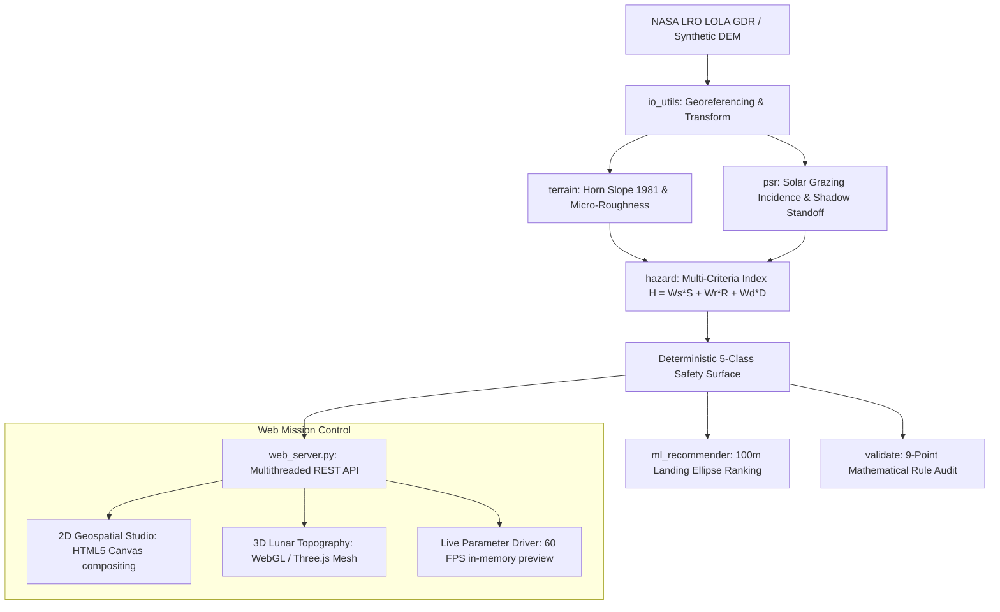

# OrbisLuna Mission Control Web Platform
## Autonomous Lunar South Pole Landing, Hazard Classification & Rover Traverse System

OrbisLuna is a full-stack mission control web application and deterministic geospatial pipeline engineered for autonomous lunar landing zone screening and rover mobility operations at the Lunar South Pole (80°S – 90°S).

---

## ⚡ Single-Command Quick Start

### Windows (One-Click / Terminal)
- **File Explorer**: Simply double-click [run_website.bat](file:///d:/OribsLuna/ORBISLUNA-kush/run_website.bat)
- **PowerShell**:
  ```powershell
  .\run_website.bat
  ```
- **Command Prompt (CMD)**:
  ```cmd
  run_website.bat
  ```
*This starts the Python backend, serves the high-performance frontend, and automatically opens [http://localhost:8050/](http://localhost:8050/) in your default browser.*

### Cross-Platform (Terminal)
```bash
# Using project virtual environment:
.venv/Scripts/python web_server.py
# Or using standard python:
python web_server.py
```
Open **[http://localhost:8050/](http://localhost:8050/)**.

---

## 🚀 Hackathon 60-Second Judge Tour

OrbisLuna includes a built-in guided tour specifically created for hackathon judges and evaluators:
1. Click the **🏆 60s Tour** button in the top-right header action bar.
2. The interactive walkthrough automatically guides you through 5 key engineering capabilities:
   - **Step 1: Truthful Provenance & Lunar Spheroid**: Displays the persistent `REAL NASA LOLA` or `SYNTHETIC DEMO` badge and the IAU 2015 Lunar Spheroid metadata strip ($R = 1,737,400\text{ m}$).
   - **Step 2: 2D Geospatial Studio & Raised PSR Outlines**: Switches to the 2D Studio and highlights the multi-layer compositing and thin white vector boundary outlines for Permanently Shadowed Regions (PSR).
   - **Step 3: Pixel Telemetry Inspector & Engineering Rationale**: Simulates inspecting a lunar coordinate on a steep crater rim, displaying exact elevation, slope, roughness, and the plain-language safety override reason.
   - **Step 4: Real-Time Dynamic Recalculation**: Adjusts safety thresholds and demonstrates client-side sub-sampled hazard preview and the live "Change vs Baseline" delta chip ($-\Delta\text{ Unsafe}$).
   - **Step 5: Scientific Validation & 9-Point Audit**: Navigates to the Validation tab to showcase the 9-point mathematical rule consistency audit ($0$ violations) and transparent disclosures regarding ground-truth reference data.

---

## 📦 Offline Demo Mode

LunaSafe is completely self-contained and operates in **100% offline mode** without requiring active internet access or waiting for long pipeline processing:
- Click **"Load Offline Demo"** in the **Data Ingestion** tab or the header.
- The app instantly loads precomputed scientific outputs directly from `outputs/`:
  - `hazard_classes.tif`: 5-Class georeferenced hazard surface
  - `slope_deg.tif`: Horn topographic slope
  - `roughness_std_m.tif`: Surface micro-relief standard deviation
  - `psr_binary.tif`: Permanently shadowed cold-trap mask
  - `psr_polygons.geojson`: Vector boundary polygons
  - `hazard_summary.csv`: Quantitative area breakdown
  - `lunasafe_hazard_map.png` & `lunasafe_hazard_map.pdf`: 300 DPI publication cartography
  - `mission_report.pdf`: 2-page executive mission safety report

---

## 🛠️ Architecture & Technology Stack



### Backend (`web_server.py`)
- **Server**: Multi-threaded Python HTTP REST API (`ThreadingHTTPServer`).
- **In-Memory Raster Cache**: Caches full-resolution DEM, slope, roughness, and PSR arrays in RAM for instantaneous $<20\text{ ms}$ parameter recalculations.
- **REST Endpoints**:
  - `GET /health`: Live pipeline status and connectivity heartbeat.
  - `GET /api/status`: Active dataset provenance, CRS, and raster dimensions.
  - `GET /api/data`: Full raster bundle for 2D and 3D rendering.
  - `POST /api/recalculate`: Real-time threshold updates with delta comparison.
  - `POST /api/audit`: Live 9-point rule consistency audit.
  - `GET /api/psr-validation`: Truthful PSR IoU and precision/recall metrics.
  - `POST /api/validate-geotiff`: Pre-flight header inspection for uploaded files.
  - `POST /api/load-offline-demo`: Instant offline demo activation.
  - `GET /api/download/<artifact>`: Direct download of GeoTIFFs, Shapefiles, and PDFs.
  - `GET /api/rover-route`: Hazard/PSR-aware rover traverse planning with per-class breakdown.
  - `GET /api/artifacts`: Manifest-driven Artifacts Hub scan (outputs + saved routes, provenance tags).
  - `GET /api/data-sources`: Public dataset registry with live local-file/checksum status and Artemis region list.
  - `GET /api/regions`: Official Artemis III candidate regions (9, Wueller et al. 2026 Table A1) + GeoJSON URL — powers the dynamic region-jump chips.
  - `GET /api/tiles/{layer}/meta.json` + `GET /api/tiles/{layer}/{z}/{x}/{y}`: Float32 raster tiles (layers: `hazard`, `illumination`; z=0, 256×256).
  - `GET /api/illumination-time[.bin]?frames=8..48`: Analytic lunar-day solar frames — JSON metadata (per-frame sun elevation/azimuth, honesty labels) plus raw uint8 binary, disk-cached by dataset/shape/latitude/model-version key. Explicitly labeled *analytic model, not observed data*; published LPSR stays authoritative for PSR.

### Frontend (`web/`)
- **Core Design System**: Clean vanilla CSS with curated lunar dark-mode palette (`#020409`, `#0a101e`), glass-morphism panels, and modern typography (`Outfit`, `Inter`, `JetBrains Mono`).
- **Mathematical Typography**: KaTeX rendering for the live multi-criteria suitability equation:
  $$H = W_s \cdot \left(\frac{\text{Slope}}{15^\circ}\right) + W_r \cdot \left(\frac{\text{Roughness}}{5.0\text{ m}}\right) + W_d \cdot \text{ShadowFraction}$$
- **2D Geospatial Studio**: Offscreen canvas compositing (9 layers incl. illumination + time overlay), per-layer opacity sliders, split swipe comparison, dynamic scale bar, grid-north arrow, and coordinate inspector.
- **Lunar-Day Time Slider**: Scrub 24 analytic solar frames with play/stop, per-frame local time + sun elevation/azimuth readout, and a modeled-shadow map overlay (`ANALYTIC MODEL` badge + disclaimer).
- **Landing-Site Comparison**: Up to 3 candidates (AI-recommended sites or map pixels) with 100 m-ellipse metrics, composite score verdict, and A/B/C map rings; keyboard `s`/`p` shortcuts.
- **Shareable URL State**: tab, tool, site, layers, view, selection, swipe, time frame, and comparison set round-trip through the URL (deep links + back/forward).
- **3D Lunar Topography Explorer**: WebGL / Three.js adaptive terrain mesh, OrbitControls, directional sun lighting with grazing angle sliders, raised vector PSR outlines, wireframe toggle, and interactive elevation transect tool with profile chart.

---

## 📜 Scientific Rules & Governance

LunaSafe strictly complies with all mission-critical guidelines:
1. **Never Invent Results**: Every metric displayed originates from real pipeline outputs (`hazard_summary.csv`, `validate.py`) or physical computations.
2. **Persistent Provenance Badges**: If running on procedural terrain, a persistent `SYNTHETIC DEMO` badge is pinned across the header and inspector. When NASA LOLA data is active, the badge switches to `REAL NASA LOLA`.
3. **Transparent Terminology**: Screening logic is labeled as deterministic `"rule-based"` or `"screening score"`, never mislabeled as "AI".
4. **No Raw LaTeX**: All mathematics is rendered via KaTeX or formatted plain text.
5. **Fixed Cartographic Hazard Palette**:
   - 🟢 **Class 1 (Safe)**: Green (`#2ecc71`)
   - 🟡 **Class 2 (Caution)**: Amber (`#f39c12`)
   - 🔴 **Class 3 (Unsafe)**: Red (`#e74c3c`)
   - 🟣 **Class 4 (Shadowed-Unknown)**: Violet (`#8e44ad`)
   - ⬛ **Class 0 (NoData)**: Slate (`#334155`)
6. **Zero Horizontal Page Scroll**: Fully responsive without horizontal scroll across `1366x768`, `1920x1080`, and `390x844` mobile displays.

---

## 📑 Artifacts & Deliverables

All deliverables can be downloaded directly from the **Artifacts Hub** tab:
- `mission_report.pdf`: 2-page executive flight certification report with embedded maps, statistics, and rule audit.
- `hazard_classes.tif`: Georeferenced uint8 raster aligned to Lunar Polar Stereographic CRS.
- `psr_binary.tif`: Binary cold-trap shadow mask.
- `psr_polygons.geojson` & `psr_shapefile.zip`: Cleaned vector boundary polygons.
- `hazard_summary.csv`: Area breakdown in square meters, square kilometers, and percentages.
- `lunasafe_hazard_map.png` & `lunasafe_hazard_map.pdf`: Archival 300 DPI publication cartography.
